# Gustavo Borges · Database Engineering

Source of [guborges.github.io](https://guborges.github.io): technical articles on Oracle, PostgreSQL and MySQL, written from real production work.

  

## About

Oracle ACE Associate · OCP · AWS Certified. Database Administrator working with mission-critical Oracle environments, plus PostgreSQL and MySQL.

## Stack

Hugo with the PaperMod theme, built and deployed to GitHub Pages by GitHub Actions on every push to `main`.

## Elsewhere

[LinkedIn](https://www.linkedin.com/in/gustavoborges/) · [YouTube](https://www.youtube.com/@DBAGustavoBorges) · [RSS](https://guborges.github.io/index.xml)
