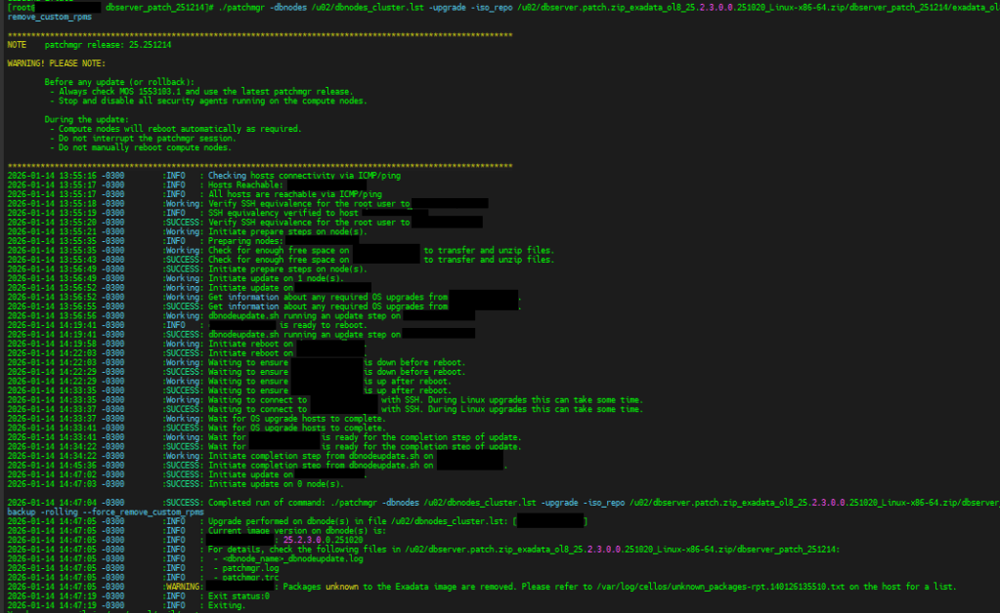

> **Origem**: Oracle Linux 7.9  
> **Destino**: Oracle Linux 8 Image 25.2.3  
> Cenário real executado com **sucesso**

Este artigo documenta um cenário real de atualização de Sistema Operacional em Exadata, no qual um ambiente produtivo com quatro DB Servers foi atualizado para Oracle Linux 8 (Image 25.2.3.0.0.251020) utilizando o patchmgr.

Não se trata de um guia teórico nem de um laboratório. É exatamente a forma como a atualização foi executada, validada e concluída com sucesso, seguindo as recomendações da Oracle, com adaptações necessárias à realidade do ambiente.

O objetivo aqui é deixar claro o que foi feito, por que foi feito e quais parâmetros foram usados, justamente para evitar discussões estéreis sobre “forma correta” sem considerar o contexto real do ambiente.

## Contexto real do ambiente

> Plataforma Exadata Database Service  
> Sistema Operacional Oracle Linux 8  
> Imagem aplicada 25.2.3.0.0.251020  
> Quantidade de DB Servers 4  
> Estratégia de execução Rolling controlado  
> Ferramenta utilizada patchmgr

Um ponto importante deste cenário é que o ambiente possuía softwares não oficiais da imagem Exadata, como agentes de monitoramento e segurança (exemplo: Zabbix e Guardicore).

Esse fator impacta diretamente a forma de execução do upgrade e explica o uso de determinados parâmetros, conforme detalhado mais adiante.

## Estratégia adotada para atualização

Embora o ambiente possuísse quatro DB Servers, a atualização **não foi feita em todos de uma vez**.

A estratégia adotada foi

- Atualização node a node
- Controle explícito via arquivo `.lst`
- Validação completa após cada node
- Avanço somente após confirmação de sucesso

Essa abordagem reduz risco, facilita troubleshooting e garante maior previsibilidade em ambientes críticos.

Exemplo conceitual do arquivo `.lst` utilizado em cada execução

```text
/u02/dbnodes_cluster.lst
dbnode01
```

Após a conclusão e validação do primeiro node, o arquivo era ajustado para o próximo servidor, repetindo exatamente o mesmo fluxo.

## Precheck via OCI

Antes de qualquer execução no sistema operacional, foi realizado **precheck via OCI**, garantindo que

- A imagem alvo era compatível com o Exadata
- O ambiente estava saudável
- Não havia operações concorrentes
- A janela de manutenção estava válida
- O upgrade poderia ser realizado em modo rolling

Esse passo é obrigatório e não foi ignorado.

Entretanto, devido à presença de **softwares não oficiais instalados no SO**, sabíamos que o precheck e a execução precisariam considerar esse cenário no nível do sistema operacional.

## Precheck técnico via patchmgr

Após o precheck no OCI, foi executado o **precheck técnico via patchmgr**, agora olhando especificamente para o estado do sistema operacional.

Comando utilizado

```text
cd /u02/dbserver.patch.zip_exadata_ol8_25.2.3.0.0.251020_Linux-x86-64.zip/dbserver_patch_251214

./patchmgr \
  -dbnodes /u02/dbnodes_cluster.lst \
  -precheck \
  -iso_repo /u02/&lt;CAMINHO_DO_REPOSITORIO_ISO>/exadata_ol8_25.2.3.0.0.251020_Linux-x86-64.zip \
  -target_version 25.2.3.0.0.251020 \
  -nomodify_at_prereq \
  --allow_active_network_mounts \
  --force_remove_custom_rpms
```

### Explicação dos parâmetros utilizados

`-dbnodes`  
Define explicitamente quais DB Servers serão afetados. Neste cenário, apenas um node por execução.

`-precheck`  
Executa validações completas sem aplicar qualquer alteração no sistema.

`-iso_repo`  
Caminho local onde está armazenada a imagem oficial do Exadata para Oracle Linux 8.

`-target_version`  
Versão exata da imagem que será aplicada. Importante sempre usar o valor completo da release.

`-nomodify_at_prereq`  
Garante que nenhuma modificação seja feita durante o precheck, mesmo que ajustes automáticos sejam possíveis.

`--allow_active_network_mounts`  
Necessário em ambientes que possuem mounts de rede ativos durante o upgrade.

`--force_remove_custom_rpms`  
Parâmetro essencial neste cenário.  
Ele força a remoção de pacotes que **não fazem parte da imagem oficial Exadata**, como agentes de monitoramento e segurança.  
Sem esse parâmetro, o precheck falharia, bloqueando a atualização.

Este ponto é crítico: o ambiente possuía softwares não oficiais, e **essa foi a forma que funcionou**, validada em produção.

## Backup do DB Server

Com o precheck aprovado, foi realizado o backup completo do DB Server antes do upgrade.

Comando utilizado

```text
cd /u02/dbserver.patch.zip_exadata_ol8_25.2.3.0.0.251020_Linux-x86-64.zip/dbserver_patch_251214

./patchmgr \
  -dbnodes /u02/dbnodes_cluster.lst \
  -backup \
  -iso_repo /u02/&lt;CAMINHO_DO_REPOSITORIO_ISO>/exadata_ol8_25.2.3.0.0.251020_Linux-x86-64.zip \
  -target_version 25.2.3.0.0.251020 \
  -nomodify_at_prereq \
  --allow_active_network_mounts \
  --force_remove_custom_rpms
```

Esse backup é o ponto de retorno caso qualquer problema ocorra durante a atualização do SO.

## Execução da atualização do Sistema Operacional

Após precheck e backup concluídos com sucesso, foi executado o upgrade definitivo do sistema operacional.

Comando utilizado

```text
cd /u02/dbserver.patch.zip_exadata_ol8_25.2.3.0.0.251020_Linux-x86-64.zip/dbserver_patch_251214

./patchmgr \
  -dbnodes /u02/dbnodes_cluster.lst \
  -upgrade \
  -iso_repo /u02/&lt;CAMINHO_DO_REPOSITORIO_ISO>/exadata_ol8_25.2.3.0.0.251020_Linux-x86-64.zip \
  -target_version 25.2.3.0.0.251020 \
  -allow_active_network_mounts \
  -nobackup \
  -rolling \
  --force_remove_custom_rpms
```

### Explicação dos parâmetros adicionais

`-upgrade`  
Inicia efetivamente a atualização do sistema operacional.

`-nobackup`  
Utilizado porque o backup já havia sido realizado previamente de forma controlada.

`-rolling`  
Garante que o upgrade seja feito de forma rolling, permitindo atualização node a node sem impacto total no ambiente.

Durante esse processo, o patchmgr

- Preparou o node
- Aplicou a nova imagem
- Executou reboot automático
- Aguardou o retorno do sistema
- Finalizou as etapas de pós-upgrade

Nenhuma ação manual foi realizada durante a execução.



## Validação pós upgrade

Após a conclusão do upgrade, foi realizada a validação final com o comando `imageinfo`.

Saída real pós atualização  
Dados sensíveis anonimizados

```text
[root@dbnode01 ~]# imageinfo

Kernel version: 5.15.0-308.179.6.16.el8uek.x86_64 #2 SMP Thu Sep 18 11:19:34 PDT 2025 x86_64
Image kernel version: 5.15.0-308.179.6.16.el8uek
Image version: 25.2.3.0.0.251020
Image activated: 2026-01-14 14:34:19 -0300
Image status: success
Exadata software version: 25.2.3.0.0.251020
Node type: GUEST
System partition on device: /dev/mapper/VGExaDb-LVDbSys1

[root@dbnode01 ~]#
```

Com o status `success`, o node foi considerado atualizado e validado. O mesmo procedimento foi então repetido para os demais DB Servers até a conclusão completa do ambiente.
