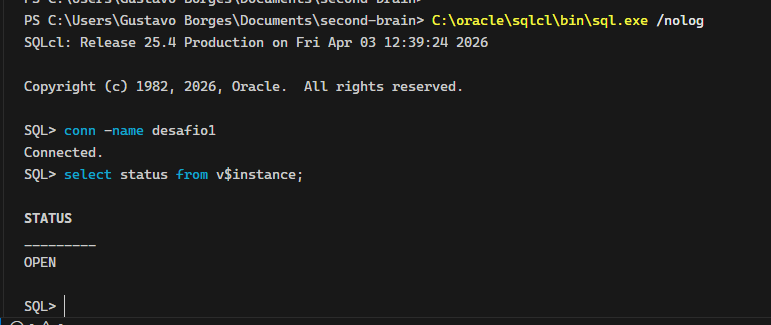
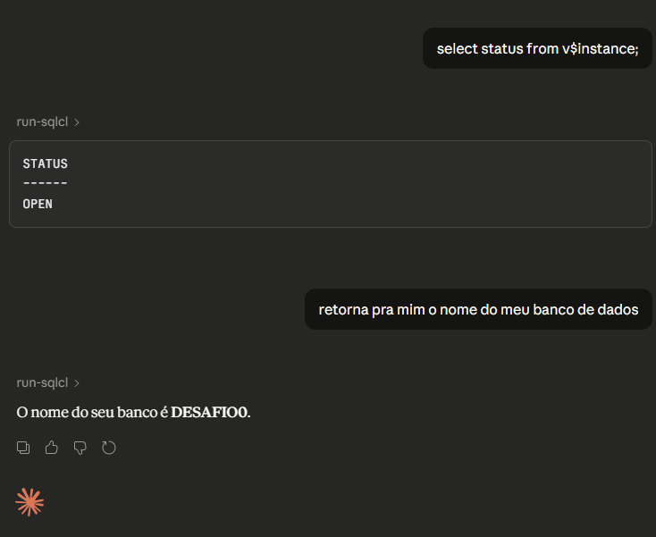
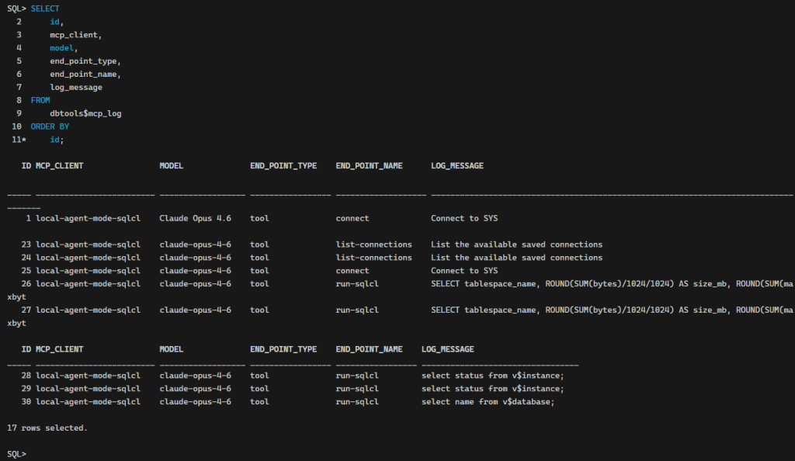
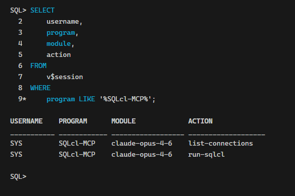

A ideia de um agente de IA conversando diretamente com um Oracle Database pareceria ficção científica há dois anos. Em 2026, é um recurso que a Oracle embarcou no SQLcl, no Autonomous Database e no Oracle Integration. O Claude da Anthropic é um dos modelos que já opera nesse ecossistema via MCP, Select AI e adapter nativo. Este post mapeia as quatro arquiteturas disponíveis, mostra como cada uma funciona na prática e foca no que mais importa para o DBA: o que proteger antes de dar acesso a um LLM ao seu banco.

## O cenário

Ambientes Oracle on-premises (19c, 21c, 23ai) e cloud (Autonomous Database, OCI). O objetivo: permitir que um agente baseado no Claude execute queries, gere relatórios, explore schemas e automatize tarefas operacionais no banco sem abrir mão de controle e auditoria.

As peças envolvidas:

- **SQLcl 25.2+** como MCP Server local
- **Oracle Autonomous AI Database MCP Server** (embedded, GA desde dezembro de 2025)
- **Select AI Agent** via DBMS_CLOUD_AI
- **Anthropic Adapter** no Oracle Integration 25.10
- **Claude Desktop**, **Claude Code**, **VS Code + Copilot/Cline** como clientes MCP

## As quatro arquiteturas

Existem quatro formas de conectar o Claude ao Oracle Database. Cada uma atende um cenário diferente e tem trade-offs de segurança, flexibilidade e complexidade.

### 1. SQLcl MCP Server (local)

O SQLcl, a partir da versão 25.2, pode rodar como servidor MCP (já incluso) . Ele roda na sua máquina (ou servidor), gerencia conexões salvas e expõe cinco tools para o LLM:

- **list-connections** - lista conexões salvas no SQLcl
- **connect** - estabelece conexão com o banco
- **disconnect** - encerra a conexão
- **run-sql** - executa SQL e PL/SQL
- **run-sqlcl** - executa comandos do SQLcl (info, ddl, load, etc.)

A configuração no Claude Desktop é um JSON de quatro linhas:

```
{
  "mcpServers": {
    "sqlcl": {
      "command": "/caminho/para/sqlcl/bin/sql",
      "args": ["-mcp"]
    }
  }
}
```


Após configurado, apenas como exemplo:



A conexão precisa ter a senha salva (conn -save nome -savepwd user/pass@host:port/service). Sem o -savepwd, o MCP Server não consegue conectar automaticamente.

Funciona com qualquer Oracle Database 19c, 21c, 23ai, 26ai on-premises ou cloud. Não precisa de Autonomous Database.

### 2. Autonomous AI Database MCP Server (embedded)

Disponível desde dezembro de 2025, esse MCP Server roda direto dentro do Autonomous AI Database. Não precisa instalar nada. O banco expõe endpoints MCP via streamable-http, e você registra tools customizadas usando o Select AI Agent.

A diferença em relação ao SQLcl MCP é que aqui você pode criar tools além das cinco padrão. O banco controla autenticação via Oracle Database Identity, aplica VPD, ACLs, lockdown profiles e audita tudo nativamente.

O trade-off: funciona apenas em Autonomous Database. Se o ambiente é on-premises, essa opção não existe.

### 3. Select AI dentro do banco

O Select AI usa o package DBMS_CLOUD_AI para chamar LLMs externos (incluindo o Claude) diretamente de dentro do banco. Você cria um perfil com o provider Anthropic:

```
BEGIN
  DBMS_CLOUD_AI.CREATE_PROFILE(
    profile_name => 'ANTHROPIC',
    attributes   => '{
      "provider": "anthropic",
      "credential_name": "ANTHROPIC_CRED",
      "model": "claude-sonnet-4-20250514",
      "object_list": [
        {"owner": "HR", "name": "EMPLOYEES"},
        {"owner": "HR", "name": "DEPARTMENTS"}
      ]
    }'
  );
END;
/
```

Depois, é possível usar comandos como:

```
SELECT AI NARRATE
  'quais são os 5 funcionários com maior salário';

SELECT AI CHAT
  'o que é Data Guard';
```

O banco gera o SQL internamente, executa, e retorna o resultado. A orquestração fica dentro do PL/SQL, o que é interessante para quem já tem lógica de negócio no banco e quer adicionar IA sem depender de ferramentas externas.

### 4. Anthropic Adapter no Oracle Integration

O Oracle Integration 25.10 (lançado em setembro de 2025) trouxe um adapter nativo para o Claude. Ele suporta text prompting e tool calling, permitindo construir fluxos de integração onde o Claude participa como um nó de decisão ou geração de conteúdo.

Casos de uso típicos: processar documentos, classificar tickets, gerar respostas automáticas em fluxos de atendimento tudo orquestrado pelo Oracle Integration com o Claude como motor de raciocínio.

## O que o agente consegue fazer na prática

Com o SQLcl MCP Server configurado, o Claude pode, por exemplo:

- Explorar o schema do banco e explicar as tabelas
- Gerar queries ad-hoc a partir de perguntas em linguagem natural
- Criar views, packages e procedures sob demanda
- Analisar execution plans e sugerir otimizações
- Gerar DDL para novos objetos
- Carregar dados de CSV para tabelas
- Converter comentários de objetos em annotations (Oracle 23ai+)
- Construir REST APIs via ORDS

Tudo isso acontece em um loop onde o LLM pede acesso a uma tool, o usuário aprova (ou não), e o MCP Server executa. O resultado volta para o LLM, que interpreta e responde.

## O que não fazer: segurança em primeiro lugar

O fato de o Claude poder executar SQL no seu banco é poderoso e perigoso ao mesmo tempo. Antes de sair configurando, considere o seguinte.

### Privilégio mínimo, sempre

A conexão usada pelo MCP Server define o que o LLM pode fazer. Se você conectar com um usuário DBA com SYSDBA, o agente pode fazer qualquer coisa inclusive coisas que você não pediu.

Crie um usuário dedicado com apenas os privilégios necessários. Se o objetivo é consultar dados, dê apenas SELECT em tabelas específicas. Se precisa criar objetos, limite a um schema de desenvolvimento.

```
CREATE USER mcp_agent IDENTIFIED BY sua_melhor_senha;

GRANT CONNECT TO mcp_agent;

GRANT SELECT ON hr.employees   TO mcp_agent;
GRANT SELECT ON hr.departments TO mcp_agent;

-- Nada mais
```

### Nunca em produção sem supervisão

O próprio Jeff Smith (Distinguished Product Manager da Oracle, responsável pelo SQLcl) enfatiza: nunca habilite auto-approve. Sempre revise o SQL gerado antes de executar. O LLM pode gerar um DROP TABLE com a mesma naturalidade com que gera um SELECT.

O ambiente ideal para testes com MCP é uma cópia de desenvolvimento ou homologação com dados sanitizados.

### Monitoramento obrigatório

O SQLcl MCP Server registra cada interação na tabela DBTOOLS$MCP_LOG. Consulte regularmente:

```
SELECT
    id,
    mcp_client,
    model,
    end_point_type,
    end_point_name,
    log_message
FROM
    dbtools$mcp_log
ORDER BY
    id;
```

Além disso, sessões MCP aparecem em V$SESSION com identificação do cliente e do modelo:

```
SELECT
    username,
    program,
    module,
    action
FROM
    v$session
WHERE
    program LIKE '%SQLcl-MCP%';
```

Todas as queries geradas pelo LLM incluem um comentário /* LLM in use is ... */, o que facilita rastrear no V$SQL, ASH e AWR.

### Riscos do protocolo MCP

O MCP ainda é um protocolo jovem (lançado pela Anthropic em novembro de 2024). Vulnerabilidades documentadas incluem:

- **Prompt injection** - conteúdo malicioso em dados do banco pode influenciar o comportamento do LLM
- **Tool poisoning** - servidores MCP maliciosos podem redefinir tools de servidores legítimos
- **Token theft** - se o servidor MCP for comprometido, tokens OAuth armazenados ficam expostos
- **Command injection** - MCP servers mal implementados podem executar comandos arbitrários no sistema operacional

Para o cenário Oracle especificamente, as defesas do próprio banco ajudam: Row Level Security, VPD, Data Redaction, SQL Firewall e Database Vault continuam ativos independentemente de quem gera o SQL seja um humano ou um LLM.

## Troubleshooting

### Problema: MCP Server não conecta ao banco

**Sintoma:** Claude retorna erro ao tentar usar a tool connect.

**Causa:** Conexão não foi salva com -savepwd, ou o caminho do SQLcl está incorreto no JSON de configuração.

**Solução:** Salve a conexão novamente:

```
sql /nolog

SQL> conn -save minha_conexao -savepwd user/pass@host:1521/service
```

Verifique com `connmgr list` se a conexão aparece. Reinicie o Claude Desktop depois de alterar o JSON.

### Problema: LLM gera SQL com erros de sintaxe

**Sintoma:** A tool `run-sql` retorna ORA-00942 ou outros erros de sintaxe.

**Causa:** O LLM nem sempre acerta a sintaxe na primeira tentativa, especialmente com objetos que não constam no schema visível.

**Solução:** Verifique se o usuário MCP tem acesso aos objetos referenciados. Use `run-sqlcl info <tabela>` para dar ao LLM contexto sobre a estrutura das tabelas.

### Problema: Claude tenta executar DDL destrutivo

**Sintoma:** O Claude sugere DROP TABLE, TRUNCATE ou ALTER TABLE sem que o usuário tenha solicitado.

**Causa:** O LLM interpreta a intenção de "limpar" ou "reorganizar" de forma agressiva.

**Solução:** Nunca dê privilégios DDL ao usuário do MCP Server em ambientes com dados que importam. E revise cada ação antes de aprovar.

## Boas práticas

- Crie um usuário Oracle exclusivo para a conexão MCP, com privilégios restritos ao mínimo necessário
- Use ambientes de desenvolvimento ou homologação para experimentação — produção só com supervisão ativa
- Nunca habilite auto-approve em nenhum cliente MCP
- Monitore DBTOOLS$MCP_LOG e V$SESSION regularmente
- Combine segurança do Oracle (VPD, Redaction, SQL Firewall) com as restrições do usuário MCP
- Documente quais schemas e tabelas estão expostos ao agente
- Revise AWR e ASH periodicamente em busca de queries com o marcador `/* LLM in use */`

## Riscos e avisos

> **ATENÇÃO:** Conectar um LLM ao banco de dados de produção sem controles adequados é um risco real de segurança. O modelo pode gerar e executar qualquer SQL que os privilégios do usuário permitam. Dados sensíveis podem ser expostos ao modelo e, dependendo do provider, processados fora do seu controle.

O Select AI envia dados e metadata para a API do Claude (api.anthropic.com). Se o ambiente exige soberania de dados, considere usar o Private Agent Factory da Oracle com modelos locais (via Ollama ou vLLM) em vez de providers externos.
