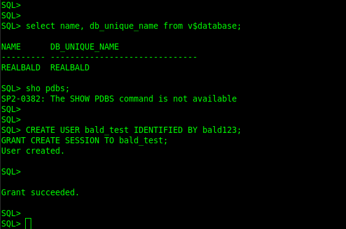
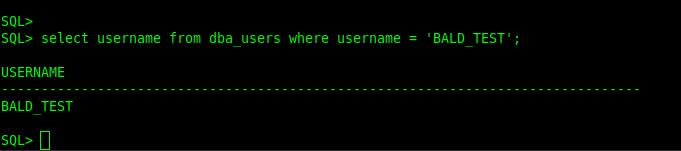
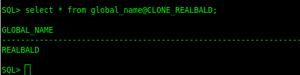
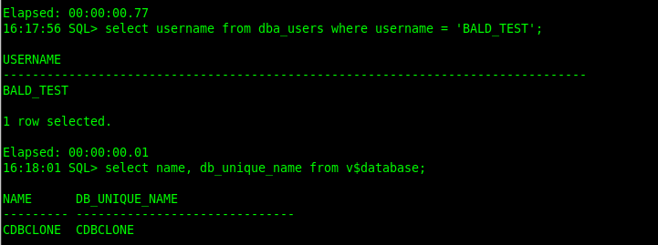

Entrar no mundo multitenant não significa apenas migrar bancos. Em muitos cenários do dia a dia, a necessidade real é clonar um banco inteiro para outro servidor, seja para criar um ambiente de homologação, um sandbox para testes, validar mudanças ou simplesmente ter uma cópia fiel do banco para troubleshooting.

Neste post eu mostro, passo a passo, como clonar um banco NON-CDB para dentro de um CDB, criando uma PDB, usando DBLINK no Oracle 19c. É uma abordagem interessante quando você quer copiar um banco completo para outro host, sem recorrer a RMAN Duplicate tradicional, aproveitando os recursos do multitenant.

O cenário é simples e totalmente reproduzível.

```
Origem
Banco REALBALD
Tipo NON-CDB
Host 192.168.56.101
```
```
Destino
Banco CDBCLONE
Tipo CDB
Host 192.168.56.102
```

O objetivo é clonar o banco REALBALD para dentro do CDBCLONE, criando uma PDB chamada BALDLAB.

As credenciais são propositalmente simples, apenas para laboratório.

Usuário remoto REMOTE_CLONE_USER  
Senha 2025!bald  
Keystore 2025!bald

Antes de clonar qualquer coisa, é importante provar que o que existe no NON-CDB realmente será refletido na PDB. Para isso, vou criar um usuário de teste na origem.

No REALBALD:

```
CREATE USER bald_test IDENTIFIED BY bald123;
GRANT CREATE SESSION TO bald_test;
```

Confirmando que o usuário existe:

```
select username from dba_users where username = 'BALD_TEST';
```

Esse usuário ainda não existe no destino e é exatamente isso que vamos validar depois da clonagem.

No banco de origem, é necessário criar um usuário que será usado pelo DBLINK para executar o clone remoto.

No REALBALD:

```
CREATE USER remote_clone_user IDENTIFIED BY "2025!bald";
GRANT CREATE SESSION, CREATE PLUGGABLE DATABASE TO remote_clone_user;
```

Esse usuário não é o dono dos dados, ele apenas viabiliza a operação de clone remoto.

Agora, no banco de destino, criamos o DBLINK apontando para o REALBALD.

No CDBCLONE, conectado no CDB root:

```
CREATE DATABASE LINK CLONE_REALBALD
CONNECT TO remote_clone_user IDENTIFIED BY "2025!bald"
USING '(DESCRIPTION=
  (ADDRESS=(PROTOCOL=TCP)(HOST=192.168.56.101)(PORT=1521))
  (CONNECT_DATA=
    (SERVER=DEDICATED)
    (SERVICE_NAME=REALBALD)
    (FAILOVER_MODE=(TYPE=select)(METHOD=basic))
  )
)';
```

Antes de seguir, sempre valido o DBLINK.

```
select * from global_name@CLONE_REALBALD;
```

Se isso funciona, a comunicação entre os bancos está ok.

Como o destino usa OMF, não preciso especificar FILE_NAME_CONVERT. O Oracle vai decidir automaticamente onde criar os datafiles da PDB.

No CDBCLONE, executo o clone propriamente dito.

```
create pluggable database BALDLAB
from REALBALD@CLONE_REALBALD
keystore identified by "2025!bald"
parallel 8;
```

Esse comando copia toda a estrutura do NON-CDB REALBALD para dentro do CDBCLONE, criando a PDB BALDLAB.

Como a origem é um NON-CDB, é obrigatório executar o processo de conversão para PDB. Esse passo não é opcional.

```
alter pluggable database BALDLAB open restricted;
alter session set container = BALDLAB;
@?/rdbms/admin/noncdb_to_pdb.sql
```

Após a conversão, valido componentes e patches.

```
select patch_id, status, description from dba_registry_sqlpatch;

select comp_id, comp_name, version, status from dba_registry;
```

Se existir qualquer divergência de patch, executo o datapatch apontando para a PDB.

```
cd $ORACLE_HOME/OPatch
./datapatch -pdb "BALDLAB" -verbose
```

Com a PDB ajustada, faço um restart simples para garantir estado limpo.

```
alter pluggable database BALDLAB close immediate;
alter pluggable database BALDLAB open;
```

Agora vem a prova final de que o clone realmente funcionou.

Conectado na PDB BALDLAB:

```
select username from dba_users where username = 'BALD_TEST';
```

O usuário criado no NON-CDB REALBALD aparece na PDB BALDLAB, comprovando que o banco foi clonado com sucesso.



Por fim, crio um service dedicado para a PDB e salvo o estado para auto open.

```
begin
    DBMS_SERVICE.CREATE_SERVICE('svc_baldlab','baldlab.local');
    DBMS_SERVICE.START_SERVICE('svc_baldlab', DBMS_SERVICE.ALL_INSTANCES);
end;
/

alter pluggable database BALDLAB save state;
```

Esse tipo de abordagem é extremamente útil quando você precisa criar ambientes de homologação, testes ou cópias técnicas de um banco existente em outro servidor, de forma controlada, reproduzível e alinhada com a arquitetura multitenant do Oracle.
