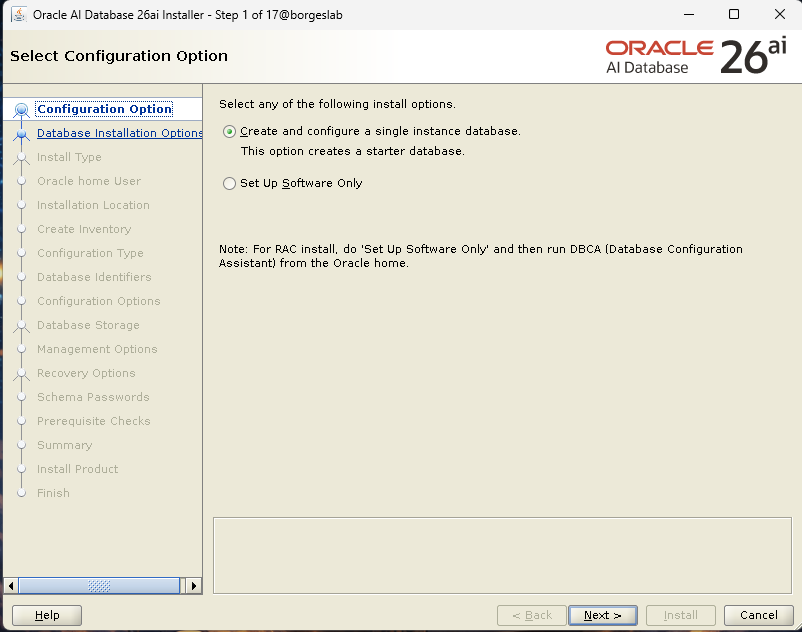
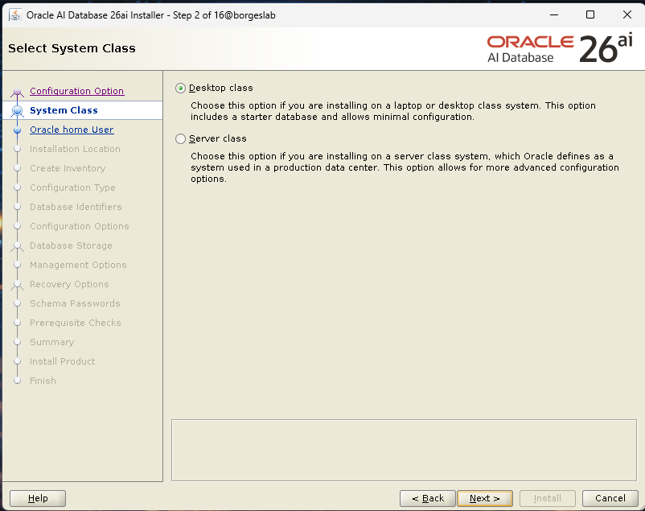
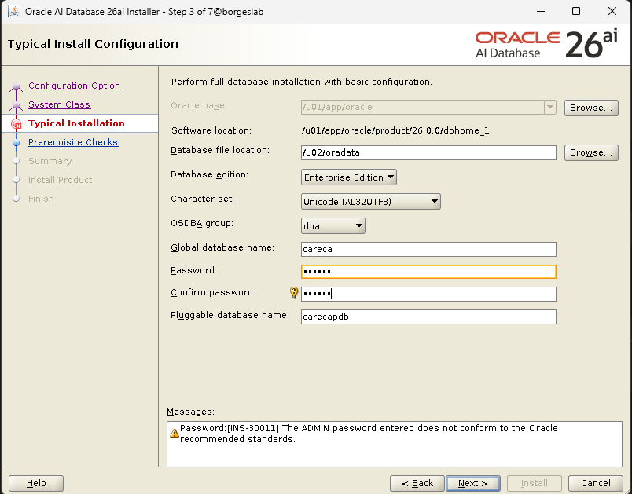
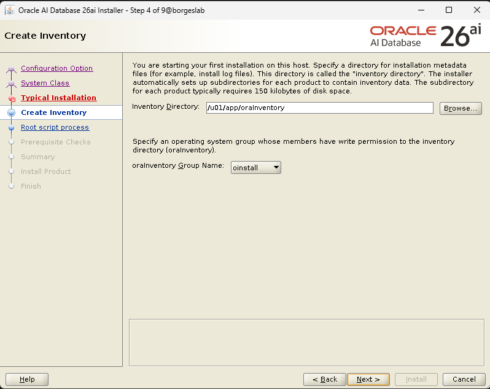
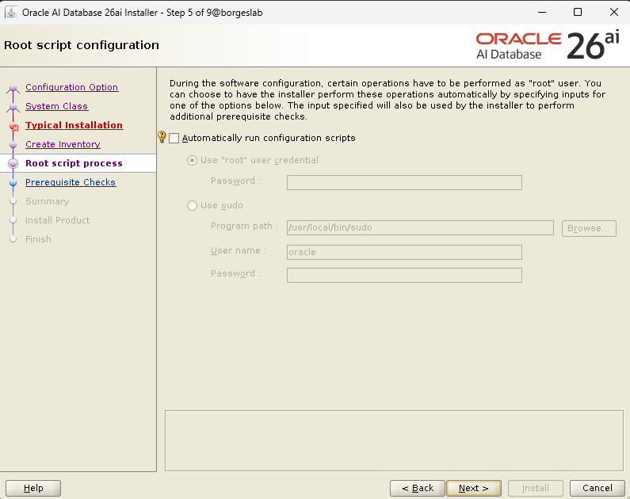
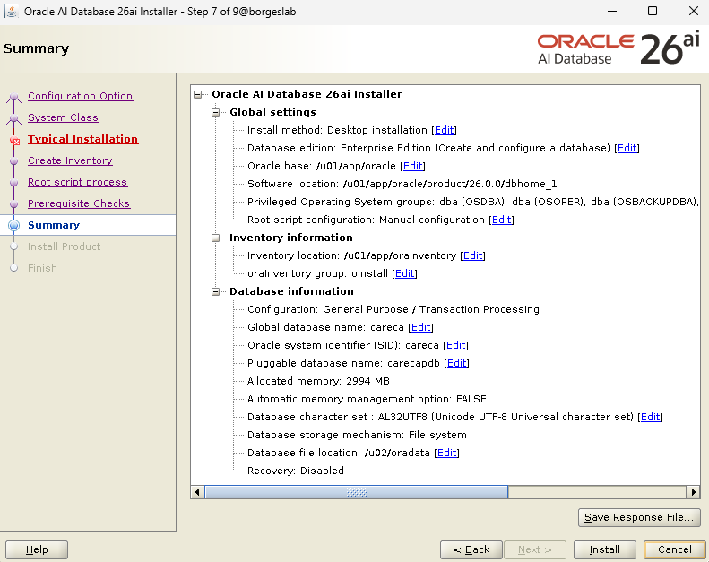
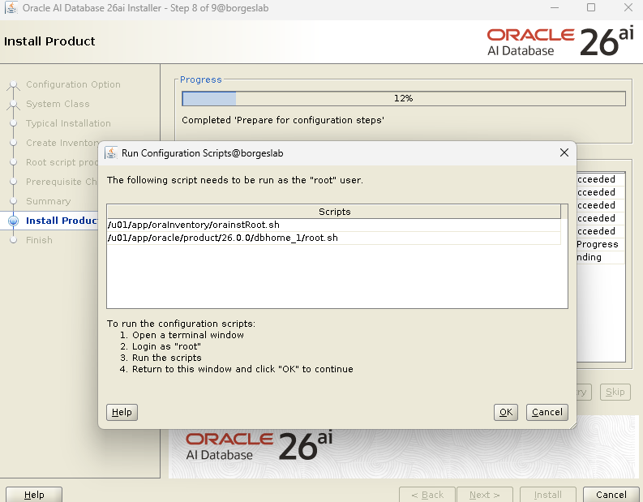
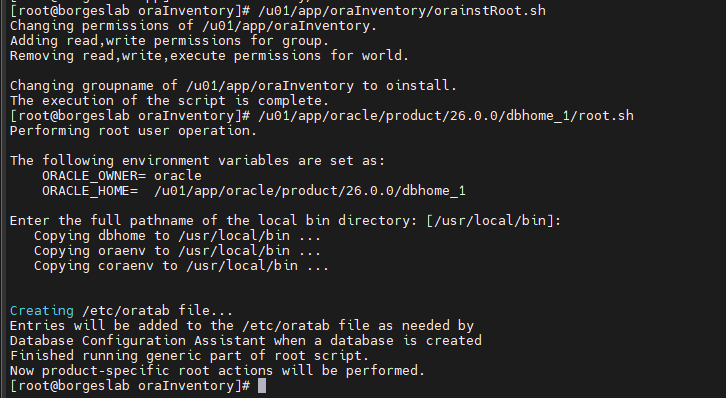
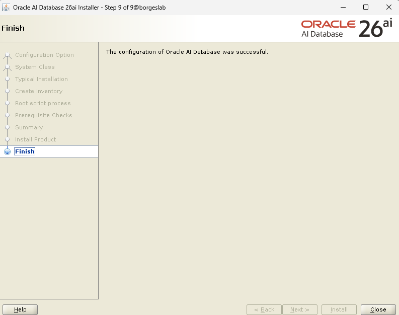
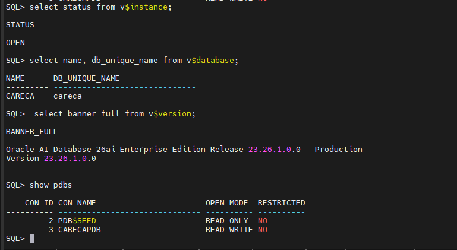

Com o lançamento do **Oracle AI Database 26ai**, a Oracle abre um novo universo de possibilidades: recursos nativos de IA, evoluções importantes na engine, melhorias para desenvolvedores e uma base preparada para o futuro.

Mas antes de explorar tudo isso, precisamos começar do começo.

Neste artigo, vou mostrar **como instalar o Oracle AI Database 26ai em um servidor Oracle Linux 9.7**, passo a passo, de forma limpa, direta e sem rodeios.

## Cenário utilizado

- Sistema Operacional: **Oracle Linux 9.7 (Minimal Install)**
- Banco de Dados: **Oracle AI Database 26ai – Enterprise Edition**
- Tipo de instalação: **Single Instance (File System)**
- Ambiente: laboratório (VM)

## Download do Oracle 26ai

O download do Oracle AI Database 26ai pode ser feito diretamente no site oficial da Oracle:

<https://www.oracle.com/database/technologies/oracle26ai-linux-downloads.html>

Arquivo utilizado neste procedimento:

```
LINUX.X64_2326100_db_home.zip
```

Esse é o **DB Home em formato ZIP**, modelo recomendado atualmente pela Oracle.

## Preparação do sistema operacional

Antes da instalação do banco, o sistema operacional já deve estar instalado e acessível.

No meu caso:

- Oracle Linux 9.7
- Hostname configurado
- Rede funcionando (NAT)

Para simplificar a preparação do ambiente, utilizei o pacote de pré-requisitos da Oracle:

```
dnf install -y oracle-database-preinstall-23ai
```
> Obs: até o momento da escrita deste artigo, a Oracle ainda não disponibilizou o pacote `preinstall` específico para o 26ai. O pacote do **23ai é totalmente compatível**.

Esse pacote cria automaticamente:

- Usuário `oracle`
- Grupos de sistema (dba, oper, etc.)
- Ajustes de kernel
- Limites de processo e memória
- Dependências de SO

## Estrutura de diretórios

Criação dos diretórios padrão utilizados pela Oracle:

```
/u01/app/oracle/product/26.0.0/dbhome_1  -> Oracle Home
/u01/app/oraInventory                    -> Inventory
/u02/oradata                             -> Datafiles
```

Comando utilizado (executado como root):

```
mkdir -p /u01/app/oracle/product/26.0.0/dbhome_1
mkdir -p /u01/app/oraInventory
mkdir -p /u02/oradata

chown -R oracle:oinstall /u01 /u02
chmod -R 775 /u01 /u02
```

## Configuração do ambiente do usuário oracle

No arquivo `.bash_profile` do usuário `oracle`:

```
export ORACLE_BASE=/u01/app/oracle
export ORACLE_HOME=$ORACLE_BASE/product/26.0.0/dbhome_1
export ORACLE_SID=careca
export PATH=$ORACLE_HOME/bin:$PATH
export LD_LIBRARY_PATH=$ORACLE_HOME/lib
export CV_ASSUME_DISTID=OL9
```

## Preparação do Oracle Home

Com o arquivo ZIP já copiado para o servidor, basta mover o arquivo para o `$ORACLE_HOME` e descompactar:

```
cd /u01/app/oracle/product/26.0.0/dbhome_1
unzip LINUX.X64_2326100_db_home.zip
```

Após o unzip, o diretório passa a conter o instalador:

```
runInstaller
```

## Instalação do Oracle AI Database 26ai (modo gráfico)

A instalação foi feita utilizando o instalador gráfico (`runInstaller`).

### Etapas principais do instalador

**Imagem 1** – Seleção da opção *Create and configure a single instance database*



**Imagem 2** – Seleção da classe do sistema (*Desktop class*)



**Imagem 3** – Configuração típica da instalação:



- Oracle Base: `/u01/app/oracle`
- Oracle Home: `/u01/app/oracle/product/26.0.0/dbhome_1`
- Local dos datafiles: `/u02/oradata`
- Character Set: `AL32UTF8`
- Database Edition: `Enterprise Edition`
- Nome do banco: `careca`
- PDB: `carecapdb`

**Imagem 4** – Criação do Oracle Inventory em `/u01/app/oraInventory`



**Imagem 5** – Configuração dos scripts de root



**Imagem 6** – Resumo da instalação



**Imagem 7** – Execução dos scripts como usuário root:




```
/u01/app/oraInventory/orainstRoot.sh
/u01/app/oracle/product/26.0.0/dbhome_1/root.sh
```

**Imagem** 8 – Finalização com sucesso



## Validação pós-instalação

Após a instalação, a validação pode ser feita conectando via SQL*Plus:


```
sqlplus / as sysdba
```

Consulta de versão:

```
select banner_full from v$version;
```

Resultado:

```
Oracle AI Database 26ai Enterprise Edition Release 23.26.1.0.0 - Production&lt;br>Version 23.26.1.0.0
```
> Importante: apesar da numeração **23.26.x**, o produto é oficialmente o **Oracle AI Database 26ai**. Essa é a nova estratégia de versionamento da Oracle.

Com isso, temos uma instalação limpa e funcional do **Oracle AI Database 26ai** rodando sobre **Oracle Linux 9.7**, pronta para explorar os novos recursos de IA, SQL, JSON, Vector Search e muito mais.

Nos próximos artigos, pretendo explorar:

- Novidades práticas do 26ai
- Casos de uso com recursos de IA
- DataGuard
- RAC
