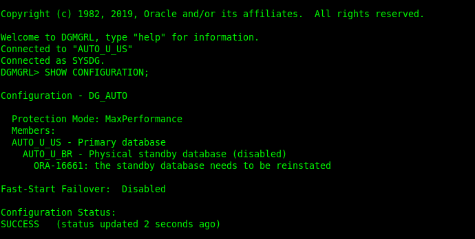
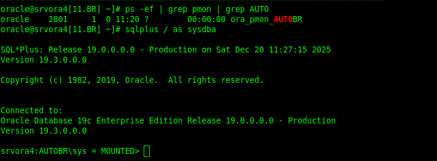
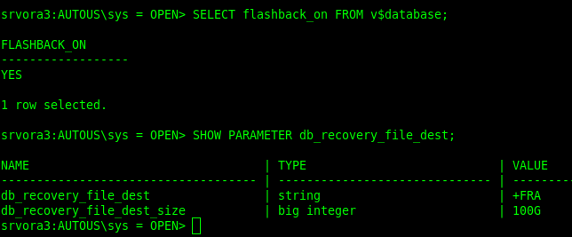
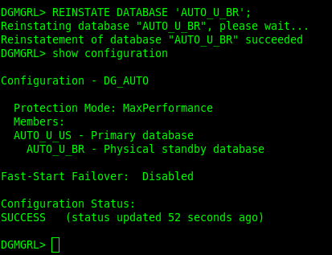
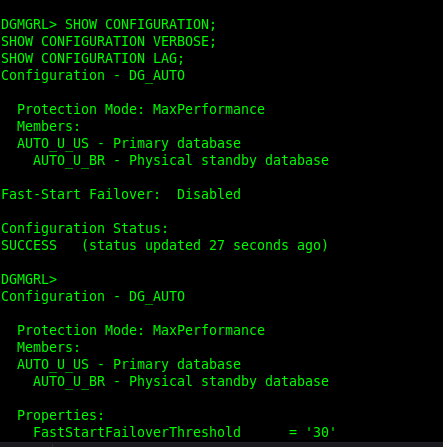
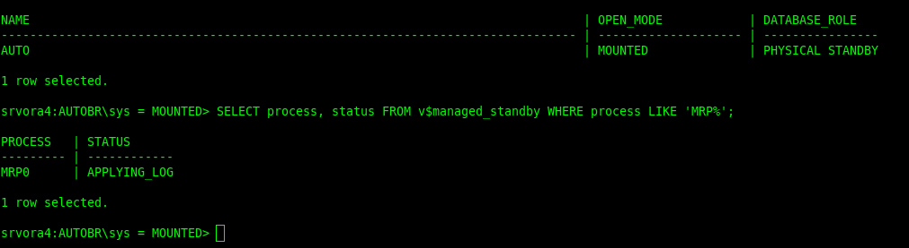
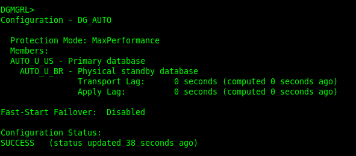
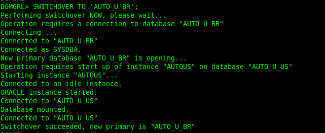
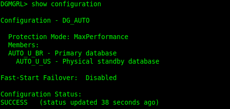

Depois de um FAILOVER em Oracle Data Guard, muita gente ainda entra direto no modo RMAN DUPLICATE, como se reconstruir o standby do zero fosse o único caminho possível. Na prática, isso quase sempre é excesso de trabalho.

Se o Flashback Database estava habilitado antes do failover, o Data Guard Broker consegue recuperar automaticamente o antigo primário e trazê-lo de volta como Physical Standby usando o comando REINSTATE DATABASE. Sem duplicate, sem restore completo e sem janelas longas.

Este artigo mostra o fluxo técnico completo para reintegrar o antigo primário após um failover utilizando exclusivamente o Data Guard Broker, com foco em Oracle 19c, mas aplicável a qualquer ambiente Data Guard bem configurado.

## O estado esperado após o failover

Após um failover bem-sucedido, o cenário normal é:

- Um banco promovido a Primary
- O antigo Primary aparecendo no Broker como DISABLED ou NEEDS REINSTATE
- Ambiente funcional, porém sem redundância até a reintegração

Esse estado não representa falha. Pelo contrário, é exatamente o ponto de partida correto para executar o REINSTATE.

O erro mais comum aqui é tentar abrir o banco antigo manualmente ou já planejar um RMAN DUPLICATE sem sequer validar se o reinstate é possível.

## Pré-requisitos reais para o REINSTATE

Antes de qualquer comando, alguns pontos precisam estar claros.

O Flashback Database precisa estar habilitado antes do failover. Não adianta ativar depois. Sem flashback logs, o reinstate não existe.

O Fast Recovery Area precisa ter espaço suficiente para aplicar os flashback logs no antigo primário.

O antigo primário precisa estar acessível, com a VM ligada e a instância iniciada apenas até o estado MOUNT. Não abra o banco.

O failover precisa estar consolidado, com o novo primário estável e o Broker saudável.

Se algum desses pontos não for atendido, o caminho correto passa a ser RMAN DUPLICATE.

## Validando o ambiente no Data Guard Broker

O primeiro passo operacional é entender exatamente como o Broker enxerga o ambiente após o failover.

No DGMGRL, valide a configuração geral e os papéis dos bancos:

```
SHOW CONFIGURATION;
SHOW CONFIGURATION VERBOSE;

SHOW DATABASE VERBOSE 'AUTO_U_US';
SHOW DATABASE VERBOSE 'AUTO_U_BR';
```

Aqui você deve confirmar que o novo primário está correto e que o antigo primário aparece como DISABLED ou NEEDS REINSTATE.

## Preparando o antigo primário

O antigo primário não deve ser aberto. Ele precisa apenas estar disponível para o Broker executar o flashback.

No sistema operacional, confirme que a instância está no ar:

```
ps -ef | grep pmon | grep AUTO
```

Se necessário, inicie o banco manualmente apenas até MOUNT:

```
sqlplus / as sysdba
STARTUP MOUNT;
```

Esse estado é suficiente. Qualquer tentativa de abrir o banco pode inviabilizar o reinstate.



## Confirmando Flashback no novo primário

Antes de executar o reinstate, confirme que o Flashback Database está ativo no novo primário:

```
SELECT flashback_on FROM v$database;
```

Também é importante validar o FRA configurado:

```
SHOW PARAMETER db_recovery_file_dest;
```

Sem flashback ativo, o Broker não consegue reconstruir o antigo primário automaticamente.



## Executando o REINSTATE via Broker

Com o ambiente validado, o processo de reintegração acontece com um único comando:

```
REINSTATE DATABASE 'AUTO_U_BR';
```

A partir daqui, o Data Guard Broker executa automaticamente:

- Flashback Database no antigo primário
- Reconfiguração do papel do banco
- Sincronização com o novo primário
- Início do apply de redo logs

Nenhuma intervenção manual é necessária durante esse processo.

## Monitorando o processo em tempo real

Durante o reinstate, o acompanhamento dos logs é obrigatório.

No antigo primário, acompanhe o alert.log e o log do Broker:

```
tail -200f /u01/app/oracle/diag/rdbms/auto_u_br/AUTOBR/trace/alert_AUTOBR.log
tail -100f /u01/app/oracle/diag/rdbms/auto_u_br/AUTOBR/trace/drcAUTOBR.log
```

No Broker, acompanhe o status e o lag:

```
SHOW CONFIGURATION;
SHOW CONFIGURATION VERBOSE;
SHOW CONFIGURATION LAG;
```

Essas validações mostram claramente o progresso da reintegração.

## Validações após o REINSTATE

Ao final do processo, o resultado esperado é:



- Novo primário operacional
- Antigo primário reintegrado como Physical Standby
- Apply de redo ativo
- Configuration Status como SUCCESS

Valide no Broker:

```
SHOW CONFIGURATION;
SHOW CONFIGURATION VERBOSE;
SHOW CONFIGURATION LAG;
```

E valide no standby via SQL:

```
SELECT name, open_mode, database_role FROM v$database;
SELECT process, status FROM v$managed_standby WHERE process LIKE 'MRP%';
```

Se o MRP estiver aplicando logs, o reinstate foi concluído com sucesso.

## Próximo passo: switchover de volta, se necessário

Com o ambiente estável, é possível executar um switchover de volta para o site original diretamente pelo Broker.

Antes do switchover, valide:

```
SHOW CONFIGURATION;
SHOW CONFIGURATION LAG;
VALIDATE DATABASE 'AUTO_U_BR';
VALIDATE DATABASE 'AUTO_U_US';
```

Execute o switchover:

```
SWITCHOVER TO 'AUTO_U_BR';
```

Após o switchover, valide novamente e garanta o apply no novo standby:

```
EDIT DATABASE 'AUTO_U_US' SET STATE='APPLY-ON';
SHOW CONFIGURATION LAG;
```

## Observação sobre licenciamento

O processo de REINSTATE não exige licença de Active Data Guard.  
O Data Guard básico, operando com o banco em MOUNT ou em READ ONLY sem apply, já está incluso na Oracle Enterprise Edition.  
O uso de Active Data Guard, que permite READ ONLY WITH APPLY e Real-Time Query, requer licenciamento adicional.

O comando REINSTATE DATABASE é uma das funcionalidades mais subutilizadas do Data Guard, apesar do impacto operacional que oferece.  
Quando o Flashback Database está corretamente configurado, o reinstate elimina rebuilds desnecessários, reduz drasticamente o tempo de recuperação e diminui de forma significativa o risco operacional.

Esse tipo de procedimento precisa estar documentado, validado em laboratório e pronto antes de qualquer incidente real. Em um cenário de failover, o objetivo não é aprender ou improvisar, é executar com previsibilidade e segurança.
