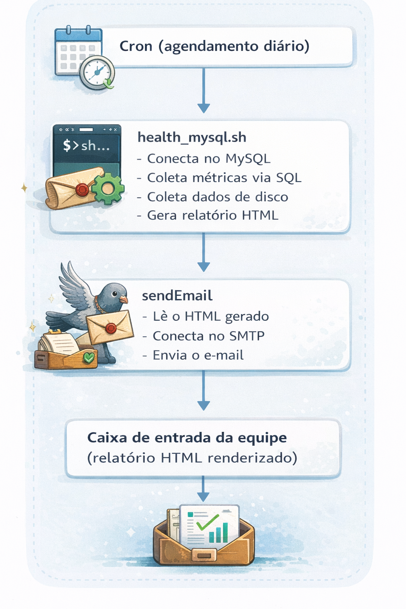
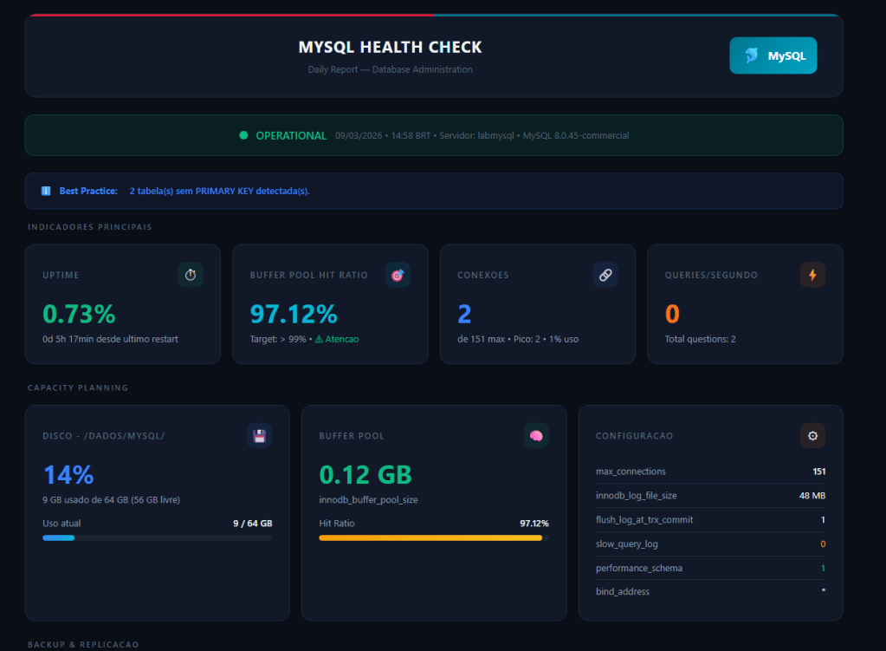

## O problema: ambientes corporativos restritos

> **O código completo do script, o HTML gerado e instruções de uso estão disponíveis no repositório:**  
> **[github.com/guborges/mysql-healthcheck](https://github.com/guborges/mysql-healthcheck)**

Quem trabalha como DBA em ambientes corporativos sabe que instalar pacotes em servidores de produção é, na maioria das vezes, burocrático ou simplesmente proibido. Existem políticas de segurança, processos de change management e equipes de infraestrutura que controlam o que entra e o que sai de cada máquina.

Agora imagina o cenário: você criou um script de health check que gera um relatório HTML completo do MySQL com métricas de buffer pool, disco, replicação, queries lentas, fragmentação e precisa enviar isso automaticamente por e-mail para a equipe. Tudo lindo, mas o servidor não tem `mailx`, não tem `postfix`, não tem `sendmail`, e você não vai conseguir instalar nenhum deles tão cedo.

Esse é o tipo de problema que aparece com frequência em servidores de banco de dados: máquinas dedicadas, com o mínimo de pacotes instalados, sem agente de e-mail local. E, no entanto, a necessidade de enviar alertas e relatórios automáticos é real e constante.

A solução que apresento aqui é o **sendEmail**, um script Perl standalone que resolve exatamente esse problema, sem instalação, sem dependências extras, sem necessidade de abrir chamado para ninguém.

## O que é o sendEmail

O sendEmail é um programa escrito em Perl que faz envio de e-mail via SMTP diretamente pela linha de comando. Ele foi criado por Brandon Zehm e, apesar de não receber atualizações há anos, continua funcionando perfeitamente para o que se propõe. O repositório oficial está em [github.com/zehm/sendEmail](https://github.com/zehm/sendEmail).

O ponto principal é: **ele é um único arquivo**. Não precisa de instalação, não precisa de compilação, não precisa de gerenciador de pacotes. Se o servidor tem Perl instalado (e praticamente qualquer Linux tem), o sendEmail funciona.

Ele se conecta diretamente ao servidor SMTP que você especificar e envia a mensagem. Não depende de MTA local (como Postfix ou Sendmail). Isso significa que ele não precisa de configuração de relay no servidor onde roda, não precisa de porta 25 aberta localmente, ele faz a conexão SMTP de saída diretamente para o destino.

Na prática, é como se fosse um cliente SMTP portátil.

## De onde surgiu a ideia

No meu caso, já conhecia o sendEmail de ambientes Oracle Exadata. Lá ele era utilizado para envio de alertas automatizados e relatórios de monitoração. Quando surgiu a necessidade de enviar relatórios de health check MySQL em um servidor RHEL 9 que não tinha nenhuma ferramenta de e-mail instalada, a solução foi simplesmente copiar o mesmo binário do sendEmail que já existia no ambiente Oracle.

Copiou, deu permissão de execução, testou, funcionou. Sem surpresas.

## Arquitetura da solução

O fluxo completo da automação funciona assim:



O script `health_mysql.sh` faz toda a coleta de dados via queries no `information_schema`, `performance_schema` e variáveis de status do MySQL. Ele monta o HTML completo inline (sem dependências externas de CSS ou JS) e depois chama o sendEmail para fazer o envio.

O resultado que chega no e-mail é um dashboard visual completo com KPIs, barras de progresso, tabelas de databases, top queries, status de replicação e alertas condicionais tudo renderizado direto no cliente de e-mail.

## Estrutura do diretório do projeto

O projeto é simples e autocontido:

```
mysql_hc/
├── health_mysql.sh       # Script principal: coleta + geração HTML + chamada do sendEmail
├── sendEmail             # Script Perl standalone para envio SMTP
└── logs/                 # Diretório de saída dos relatórios HTML
    ├── mysql_healthcheck_20260309_145800.html
    ├── mysql_healthcheck_20260310_080000.html
    └── mysql_healthcheck_latest.html   # Symlink/cópia do último relatório
```

O diretório `logs/` é criado automaticamente pelo script. Os relatórios são nomeados com timestamp e existe uma cópia do último relatório gerado em `mysql_healthcheck_latest.html` para consulta rápida. O script mantém apenas os 30 relatórios mais recentes, removendo automaticamente os mais antigos.

## Como o script chama o sendEmail

No final do `health_mysql.sh`, a chamada para envio do e-mail é feita assim:

```
SEND_EMAIL="/usr/bin/perl /home/mysqlemail/sendEmail"

${SEND_EMAIL} \
  -f ${EMAIL_FROM} \
  -t destinatario1@empresa.com.br \
  -t destinatario2@empresa.com.br \
  -u "${EMAIL_SUBJECT}" \
  -o message-file=${HTML_FILE} \
  -o message-content-type=html \
  -o tls=no
```

Repare que a invocação é feita explicitamente com `/usr/bin/perl` seguido do path do script sendEmail. Isso garante que ele será executado mesmo que não tenha permissão de execução direta ou que não esteja no PATH do sistema.

## Principais parâmetros do sendEmail

Esses são os parâmetros que uso na automação e que cobrem a maioria dos cenários:

**`-f` (from)**  
Endereço do remetente. Em ambientes corporativos, normalmente se usa um endereço genérico que identifica o servidor ou o serviço, por exemplo `dba-mysql@empresa.com.br`. Alguns servidores SMTP validam o domínio do remetente, então é importante usar um endereço que o relay aceite.

**`-t` (to)**  
Endereço do destinatário. Pode ser usado múltiplas vezes para enviar para vários destinatários. Cada `-t` adiciona um novo endereço à lista.

**`-u` (subject)**  
Assunto do e-mail. No caso do health check, incluo o hostname do servidor e a data para facilitar a identificação na caixa de entrada: `MySQL Health Check - labmysql - 10/03/2026`.

**`-o message-file`**  
Caminho do arquivo que será usado como corpo do e-mail. Em vez de passar o conteúdo inline (o que seria inviável com HTML complexo), esse parâmetro aponta para o arquivo HTML gerado. O sendEmail lê o conteúdo do arquivo e o usa como body da mensagem.

**`-o message-content-type`**  
Define o content-type da mensagem. Para enviar HTML renderizado (e não o código-fonte em texto plano), é obrigatório usar `html`. Sem esse parâmetro, o destinatário recebe as tags HTML como texto.

**`-o tls`**  
Controla o uso de TLS na conexão SMTP. Em redes internas corporativas onde o relay SMTP é local, normalmente uso `tls=no`. Se estiver enviando através de um SMTP externo (como Gmail ou Office 365), é necessário usar `tls=yes` e possivelmente passar credenciais com `-xu` e `-xp`.

## Reutilizando o sendEmail entre servidores

Uma das maiores vantagens do sendEmail é a portabilidade. Como ele é um arquivo Perl único, sem dependências além do interpretador Perl padrão, basta copiar o arquivo de um servidor para outro.

Na prática, o que fiz foi:

```
# No servidor de origem (Exadata, por exemplo):
scp /opt/scripts/sendEmail usuario@novo-servidor:/home/mysqlemail/sendEmail

# No servidor de destino:
chmod +x /home/mysqlemail/sendEmail
```

Feito. Não precisa instalar módulos CPAN adicionais, não precisa ajustar variáveis de ambiente, não precisa configurar nada no sistema operacional. O sendEmail funciona out of the box em qualquer Linux com Perl o que inclui RHEL, CentOS, Oracle Linux, Ubuntu, Debian e praticamente qualquer outra distribuição.

Isso é especialmente útil quando você administra vários servidores de banco de dados e quer padronizar o envio de relatórios e alertas sem ter que pedir a instalação de pacotes em cada um deles.

## O relatório HTML e as queries de coleta

O relatório que o script produz é um HTML completo e autossuficiente, com CSS inline. Ele não depende de arquivos externos, imagens hospedadas ou JavaScript. Isso é intencional clientes de e-mail bloqueiam conteúdo externo por padrão, então tudo precisa estar embutido no próprio HTML para renderizar corretamente.



Toda a coleta de dados é feita via queries diretas no MySQL. Para dar uma ideia, algumas das consultas utilizadas no script:

**Databases por tamanho e fragmentação** consulta no `information_schema.tables` agregando `data_length`, `index_length` e `data_free` por schema:

```
SELECT
    table_schema,
    ROUND(SUM(data_length + index_length) / 1024 / 1024, 2) AS size_mb,
    COUNT(*) AS tables_count,
    ROUND(SUM(data_free) / 1024 / 1024, 2) AS frag_mb
FROM information_schema.tables
WHERE table_schema NOT IN (
    'information_schema',
    'performance_schema',
    'sys'
)
GROUP BY table_schema
ORDER BY SUM(data_length + index_length) DESC;
```

**Top queries por tempo médio** consulta no `performance_schema.events_statements_summary_by_digest`:

```
SELECT
    LEFT(DIGEST_TEXT, 80),
    COUNT_STAR,
    ROUND(AVG_TIMER_WAIT / 1000000000000, 3) AS avg_seconds,
    SUM_ROWS_EXAMINED
FROM performance_schema.events_statements_summary_by_digest
WHERE SCHEMA_NAME NOT IN (
    'mysql',
    'information_schema',
    'performance_schema',
    'sys'
)
AND DIGEST_TEXT IS NOT NULL
ORDER BY AVG_TIMER_WAIT DESC
LIMIT 5;
```

**Tabelas sem PRIMARY KEY** join entre `information_schema.tables` e `table_constraints`:

```
SELECT
    COUNT(*)
FROM information_schema.tables t
LEFT JOIN information_schema.table_constraints tc
       ON t.table_schema = tc.table_schema
      AND t.table_name = tc.table_name
      AND tc.constraint_type = 'PRIMARY KEY'
WHERE tc.constraint_name IS NULL
  AND t.table_schema NOT IN (
      'mysql',
      'information_schema',
      'performance_schema',
      'sys'
  )
  AND t.table_type = 'BASE TABLE';
```

Além das queries, o script também coleta variáveis de status (`SHOW STATUS`), variáveis globais (`SELECT @@variable`), status de replicação (`SHOW REPLICA STATUS`) e dados de disco via `df`. Tudo isso é combinado com lógica condicional em Bash para gerar alertas dinâmicos e classificar o status geral do servidor.

O resultado final é um dashboard com KPIs, barras de progresso, tabelas detalhadas e alertas coloridos tudo renderizado direto no cliente de e-mail.

Para não estender demais este artigo, optei por manter aqui apenas os trechos mais relevantes. No repositório você encontra o script completo com todas as queries, a geração HTML, os alertas condicionais e um exemplo real do relatório renderizado.

## Agendamento via cron

Para execução automática diária, basta adicionar uma entrada no crontab:

```
# Health Check MySQL - execução diária às 08:00
0 8 * * * /home/mysqlemail/mysql_hc/health_mysql.sh >> /home/mysqlemail/mysql_hc/logs/healthcheck_cron.log 2>&amp;1
```

A saída do script (logs de execução, não o HTML) é redirecionada para um arquivo de log separado. Isso permite verificar se houve erros na coleta ou no envio sem precisar olhar o syslog.

## Conclusão

O sendEmail resolve um problema real e recorrente de quem administra bancos de dados em ambientes corporativos: a necessidade de enviar relatórios e alertas automáticos a partir de servidores que não possuem e provavelmente nunca terão um agente de e-mail instalado.

A combinação de um script Bash de coleta com geração de HTML inline e envio via sendEmail forma uma solução completa, portátil e que não depende de ninguém para ser implantada. O DBA copia os arquivos, configura o cron e pronto.

Essa mesma abordagem pode ser adaptada para qualquer banco de dados (Oracle, PostgreSQL, SQL Server) ou qualquer outro tipo de automação que precise notificar por e-mail. O sendEmail não se importa com o conteúdo ele envia o que você mandar.

Se você trabalha com bancos de dados e ainda não conhecia o sendEmail, recomendo guardar esse script no seu toolkit. Em algum momento, vai precisar dele.

**Repositório com o projeto completo:** [Github](https://github.com/guborges/MySQL-Health-Check-Relat-rio-automatizado-com-envio-por-e-mail)
