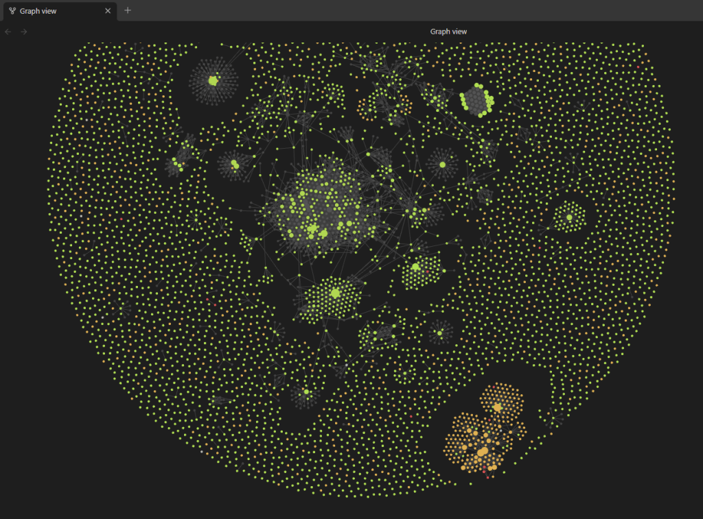
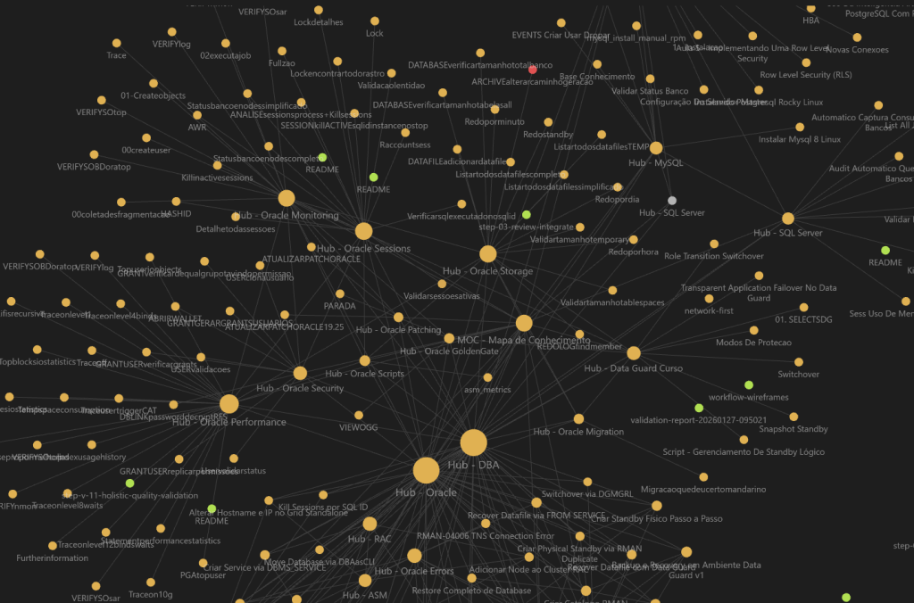

DBA que opera ambientes críticos lida com um volume absurdo de informação técnica. Versões, parâmetros, topologias, incidentes passados, runbooks, scripts de diagnóstico. O problema não é falta de conhecimento, é recuperar o que você já sabe na hora que precisa. Este post mostra como montei um sistema de contexto persistente usando Claude e Obsidian para operar ambientes Oracle RAC, Data Guard e Exadata no dia-a-dia.

## O cenário

Ambientes Oracle 19c em Exadata com RAC (2 nós), Data Guard físico ativo, ASM com disk groups DATA e FRA. Além disso, instâncias MySQL em replicação e clusters PostgreSQL com streaming replication. Dezenas de databases, múltiplas versões, change management formal com aprovações multi-nível, e um comitê técnico mensal que exige apresentações estruturadas.

O denominador comum: tudo depende de contexto. Saber qual parâmetro foi alterado naquele change de três meses atrás. Lembrar qual SQL causou contenção de PX na semana passada. Ter na mão a topologia exata do ambiente antes de executar um switchover.

A maioria dos DBAs ( que eu conheço ) armazena conhecimento operacional de formas que não escalam. Favoritos no browser apontando pra páginas que já saíram do ar. Scripts soltos em diretórios aleatórios nos servidores. Documentos no Google Docs ou SharePoint que ninguém lembra que existem. Mensagens no Teams enterradas no histórico.

O resultado: quando aparece um incidente parecido com algo que você já resolveu, você refaz o diagnóstico do zero. Quando precisa montar uma apresentação para o comitê, vasculha e-mails tentando encontrar dados. Quando um colega pede ajuda com um procedimento, você explica de cabeça porque não documentou na época.

Esse ciclo se repete durante toda a carreira de um DBA que não tem um sistema estruturado de gestão de conhecimento.

## Diagnóstico: o que falta no workflow do DBA

O problema tem três componentes:

Falta de persistência. O conhecimento operacional fica na cabeça do DBA ou em conversas efêmeras. Quando o DBA sai de férias, de licença ou da empresa, o conhecimento vai junto.

Falta de contexto. Ferramentas de IA genéricas não sabem que você opera Oracle 19c em Exadata, que seu Data Guard tem failover automático desabilitado, ou que o time de aplicação usa Quartz Scheduler com lock tables que causam contenção de TX. Toda conversa começa do zero.

Falta de estrutura. Mesmo quando a informação existe, ela está espalhada em formatos incompatíveis, sem tags, sem links, sem possibilidade de busca cruzada.

## Solução: Obsidian como repositório, Claude como motor de contexto

A combinação que uso resolve os três problemas.

O Obsidian é um editor de notas baseado em Markdown, local, sem dependência de cloud. Tudo fica em arquivos de texto plano organizados em pastas, com links internos entre notas (wiki-links), tags, e metadados no frontmatter YAML. Se o Obsidian morrer amanhã, os arquivos continuam legíveis em qualquer editor. Sem lock-in.

O Claude resolve o problema do contexto. Com os Projects do Claude, eu configuro instruções persistentes que descrevem meu ambiente, faço upload de documentação de referência, e mantenho conversas focadas por área técnica. A memória do Claude entre sessões permite que ele saiba meu perfil profissional sem que eu re-explique a cada conversa. E os skills customizados automatizam tarefas repetitivas de documentação.

## Passo 1: estrutura do vault no Obsidian

A organização do vault segue um princípio simples: se eu preciso encontrar algo rápido, a estrutura precisa refletir isso.

```
DBA-Vault/
├── 00-Dashboard/
│   └── dashboard.md
├── 01-Ambientes/
│   ├── RACPROD01/
│   │   └── racprod01.md
│   ├── DGSTANDBY01/
│   │   └── dgstandby01.md
│   ├── APPDB01/
│   │   └── appdb01.md
│   └── [cada ambiente com sua nota]
├── 02-Runbooks/
│   ├── switchover-dataguard.md
│   ├── temp-tablespace-cleanup.md
│   ├── datapatch-pos-psu.md
│   └── rac-node-restart.md
├── 03-Incidentes/
│   ├── 2025-03-incident-cpu-px.md
│   ├── 2025-02-conectividade-monitoramento.md
│   └── [cada incidente como nota]
├── 04-Scripts/
│   ├── diagnostico/
│   ├── monitoramento/
│   └── manutencao/
├── 05-Referencia/
│   ├── oracle-19c-parametros.md
│   ├── awr-interpretacao.md
│   └── ora-errors-comuns.md
├── 06-Changes/
│   ├── templates/
│   └── historico/
├── 07-MySQL/
├── 08-PostgreSQL/
└── Templates/
    ├── incidente.md
    ├── runbook.md
    └── ambiente.md
```

Cada nota de ambiente contém informações fixas: versão do Oracle, número de nós RAC, tipo de storage, disk groups (DATA, FRA), configuração de listeners, setup do Data Guard, parâmetros não-default relevantes, e contato do time de aplicação. Quando chega um chamado, abro a nota e tenho o contexto na mão.



Aqui um exemplo de como está meu obsidian hoje, cada ponto é uma documentação e suas conexões.

Os runbooks seguem formato padronizado: pré-requisitos, passos com comandos reais, validação pós-procedimento, troubleshooting, riscos. Qualquer DBA do time executa sem depender de quem escreveu.



## Passo 2: templates com frontmatter para consulta via Dataview

O plugin Dataview do Obsidian transforma o vault numa base de dados consultável, mas só funciona se os metadados estiverem corretos. Cada tipo de nota tem um template com frontmatter YAML:

```
---
tipo: incidente
data: {{date}}
ambiente: RACPROD01
severidade: alta
status: resolvido
causa_raiz: plano de execução alterado após coleta de estatísticas
tags: [oracle, rac, performance, px-contention]
---

# Incidente: contenção de CPU por PX flow control

## Contexto
Ambiente Oracle 19c RAC (2 nós) em Exadata. Alerta de CPU
disparou às 14h. Dois SQL IDs consumindo 73% do DB Time combinado.

## Diagnóstico
```sql
-- Identificar top SQL por CPU
SELECT sql_id, elapsed_time/1e6 elapsed_sec,
       cpu_time/1e6 cpu_sec, executions
FROM   v$sql
WHERE  cpu_time > 1e9
ORDER  BY cpu_time DESC
FETCH FIRST 10 ROWS ONLY;
```

ASH confirmou contenção de PX flow control em ambos os nós.
Plano de execução mudou após coleta de estatísticas na noite anterior.

## Ação tomada
Verificado histórico de planos via DBA_HIST_SQL_PLAN.
Confirmado bind variable peeking como causa da mudança de plano.
SQL Profile criado para estabilizar o plano anterior.

## Validação
```sql
-- Confirmar plano estabilizado
SELECT plan_hash_value, executions, elapsed_time/executions avg_elapsed
FROM   v$sql
WHERE  sql_id = 'abc123def';
```

CPU normalizou em 15 minutos. Alerta fechado.

## Lições aprendidas
Monitorar alterações de plano após janela de coleta de estatísticas.
Considerar SQL Plan Baselines para os top 10 SQL do ambiente.
```

Com essa estrutura, uma query Dataview no dashboard retorna todos os incidentes de severidade alta, ou todos os incidentes de um ambiente específico, ou tudo que aconteceu no último mês:

```
TABLE ambiente, severidade, causa_raiz
FROM "03-Incidentes"
WHERE tipo = "incidente" AND severidade = "alta"
SORT data DESC
```

## Passo 3: Claude Projects como camada de contexto

O problema de usar qualquer LLM para trabalho técnico é o cold start. Cada conversa começa do zero. Você precisa explicar que opera Oracle 19c em Exadata, que tem RAC com 2 nós, que o Data Guard é físico ativo, que o time de aplicação roda Java com Quartz Scheduler.

Os Projects do Claude resolvem isso. Cada projeto mantém instruções persistentes e uma base de documentos que o Claude consulta automaticamente em todas as conversas daquele projeto.

A estrutura que uso:

```
Projeto: Oracle Operations
├── Instruções customizadas:
│   - Ambiente padrão: Oracle 19c em Exadata
│   - RAC com 2 nós, ASM, Data Guard físico
│   - Respostas devem incluir comandos reais, não pseudocódigo
│   - Validações pós-procedimento são obrigatórias
│   - Formato de output: Markdown compatível com Obsidian
│
├── Knowledge base:
│   - Referência rápida de parâmetros Oracle 19c
│   - Template de runbook
│   - Template de incidente
│   - Lista de ORA errors mais frequentes do ambiente
│
└── Conversas:
    - Cada incidente como conversa separada
    - Cada runbook novo como conversa separada
    - Análises de AWR como conversas dedicadas
```

Quando abro uma conversa nesse projeto e digo "recebi alerta de contenção de TX no ambiente RAC, Quartz Scheduler locks", o Claude já tem contexto suficiente pra saber do que estou falando e sugerir investigação direcionada.

## Passo 4: memória entre sessões

Além dos Projects, o Claude mantém memória entre conversas. Ele sabe que sou DBA Oracle com experiência em Exadata, que gerencio MySQL e PostgreSQL, que uso change management formal. Isso significa que mesmo fora de um projeto específico, as respostas já chegam calibradas pro meu nível e contexto.

Na prática, a memória funciona como um perfil profissional persistente. Eu não preciso dizer "sou DBA sênior, trabalho com Oracle RAC" a cada conversa. O Claude já sabe. O resultado é que as respostas pulam o nível básico e vão direto ao ponto.

## Passo 5: workflow completo em ação

Vou mostrar como os componentes se conectam num cenário real.

**Situação:** alerta de CPU em ambiente Oracle RAC no Exadata. Dois SQL IDs causando contenção.

**Passo 1 - Obsidian:** abro a nota do ambiente (`01-Ambientes/RACPROD01/racprod01.md`) pra confirmar topologia, versão e parâmetros relevantes.

**Passo 2 - Claude:** no projeto Oracle Operations, abro conversa nova e colo os dados do diagnóstico:

```
Top SQL por CPU:
SQL_ID: abc123def - 45% DB Time - Full Table Scan em tabela grande
SQL_ID: xyz789ghi - 28% DB Time - PX flow control waits
ASH mostra contenção em ambos os nós.
Plano de execução mudou após coleta de estatísticas ontem.
```

O Claude analisa, sugere verificar histórico de planos via `DBA_HIST_SQL_PLAN`, confirmar bind variable peeking, e propõe rascunho de mensagem para o time de desenvolvimento.

**Passo 3 - Claude:** depois de resolver, peço pro Claude gerar a nota de incidente no formato do meu template Obsidian.

**Passo 4 - Obsidian:** copio o Markdown, adiciono wiki-links (`[[RACPROD01]]`, `[[runbook-px-tuning]]`), ajusto o que precisar e salvo.

Tempo total de documentação: menos de 15 minutos. Sem esse workflow, seriam 40 minutos ou mais, se eu documentasse, e na maioria das vezes não documentava.

## Integração MCP: Claude com acesso direto ao vault

Existe a possibilidade de eliminar a etapa manual de copiar Markdown via MCP (Model Context Protocol). O MCP é uma especificação aberta da Anthropic que permite conectar o Claude Desktop diretamente a ferramentas externas, incluindo o vault do Obsidian.

A configuração envolve o plugin Local REST API no Obsidian e um MCP server:

```
{
  "mcpServers": {
    "obsidian": {
      "command": "npx",
      "args": ["@mauricio.wolff/mcp-obsidian@latest", "/caminho/do/vault"]
    }
  }
}
```

Com isso, o Claude consegue criar notas diretamente no vault, buscar conteúdo existente e atualizar documentação sem sair da conversa. Ainda estou avaliando essa integração pra uso no dia-a-dia, mas o potencial é claro.

Aviso: ao dar acesso de leitura e escrita ao vault, faça backup completo antes. A integração via MCP depende de plugins da comunidade e Node.js v18+.

## Outros usos do workflow

Além da documentação de incidentes, uso a mesma combinação para:

Análise de AWR. Colo trechos relevantes no Claude e peço triagem focada nos top wait events. Ele identifica padrões, compara com comportamentos conhecidos e sugere investigação. Não substitui a interpretação do DBA, mas acelera a triagem inicial.

Comunicados técnicos. Quando preciso notificar o time de desenvolvimento sobre um SQL problemático ou contenção de locks, escrevo o contexto e o Claude gera o rascunho no tom certo. Direto, técnico, sem alarmismo.

Preparação de apresentações. Material para o comitê técnico mensal: o Claude recebe métricas brutas, incidentes do período e status de projetos, e gera a estrutura dos slides.

Delegação de tarefas. Para colegas juniores, o Claude gera scripts de coleta de dados com instruções claras, permitindo que executem tarefas de diagnóstico autonomamente.

## Troubleshooting

### Problema: Claude perde contexto em conversas longas

**Sintoma:** após colar vários AWR reports, o Claude começa a confundir dados entre os reports.

**Causa:** limite de contexto atingido. O Claude compacta informações antigas para abrir espaço.

**Solução:** manter conversas curtas e focadas. Uma conversa por incidente, uma conversa por runbook. Se precisar de análise comparativa entre AWR reports, extrair os dados relevantes antes de colar.

### Problema: output do Claude não segue o template do Obsidian

**Sintoma:** o Markdown gerado não tem o frontmatter correto ou usa formatação incompatível.

**Causa:** instruções do projeto incompletas ou genéricas demais.

**Solução:** incluir o template completo (com frontmatter YAML) nas instruções do projeto ou na knowledge base. Quanto mais específico, mais consistente o output.

### Problema: Dataview não encontra as notas

**Sintoma:** queries do Dataview retornam vazio mesmo com notas existentes.

**Causa:** frontmatter com erros de sintaxe YAML (aspas faltando, indentação errada).

**Solução:** validar o YAML do frontmatter. Campos com dois pontos no valor precisam de aspas. Tags devem ser arrays (`[tag1, tag2]`).

## Boas práticas

Comece pelo que dói mais. Se o problema é documentar incidentes, comece por aí. Não tente montar o vault perfeito do zero.

Padronize os templates antes de produzir conteúdo. Mudar o formato depois que você tem 50 notas gera retrabalho.

Use tags e frontmatter de forma consistente. O Dataview só funciona se os metadados estiverem corretos.

Configure o Claude com instruções específicas do seu ambiente. Quanto mais contexto nas instruções do projeto, menos tempo gasto explicando em cada conversa.

Revise sempre. O Claude gera conteúdo de qualidade, mas erros técnicos acontecem. Nunca execute um procedimento em produção baseado em output do Claude sem revisão humana.

Nunca inclua informações sensíveis nas conversas com o Claude. Nomes reais de ambientes produtivos, senhas, connection strings com credenciais, dados de clientes: use placeholders em tudo.

## Atenção!!

O Obsidian armazena tudo localmente em texto plano. Se o vault contém informações sensíveis da empresa, avalie criptografia de disco e controle de acesso ao diretório.

A integração MCP dá acesso de leitura e escrita ao vault. Backup antes de habilitar. Monitore os logs do MCP server.

O Claude não tem acesso aos servidores de banco. Ele não executa queries, não lê alert logs, não consulta views de dicionário. Toda informação precisa ser fornecida manualmente. Isso é uma limitação e também uma camada de segurança. Não quero IA com acesso direto a bancos de produção.
