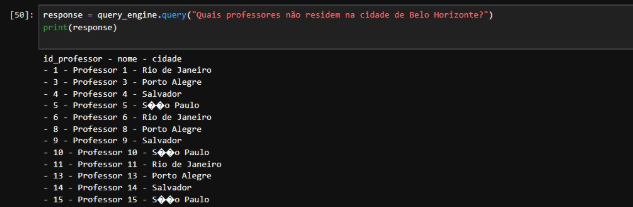

Quando falo de agentes, estou falando de software que entende uma tarefa, escolhe quais ferramentas usar e executa passos até entregar um resultado. Em vez de um prompt isolado, o agente combina um modelo de linguagem com recursos externos como banco de dados, arquivos e APIs. Ele planeja, consulta, interpreta e responde em linguagem natural.

Aqui eu montei um agente focado em dado relacional. A ideia é simples: fazer perguntas em português e receber respostas vindas de um Oracle. O LlamaIndex organiza o fluxo de trabalho, o Groq fornece o modelo de linguagem e o Python conecta no banco com SQLAlchemy. Para aumentar a precisão, descrevo o esquema e os relacionamentos das tabelas para o modelo gerar SQL melhor. Para garantir compatibilidade, passo as consultas por um saneador que ajusta a sintaxe para Oracle 19c e executa com segurança. O resultado é um agente que transforma pergunta em SQL e devolve a resposta pronta para ler.

# Contexto

- Banco Oracle 19c com service name orcl
- Schema ESCOLA com as tabelas ALUNOS, PROFESSORES e DISCIPLINAS
- Python em ambiente virtual e Jupyter Lab
- LlamaIndex para orquestrar, Groq como LLM, SQLAlchemy + oracledb para a conexão
- Chave da Groq em GROQ_API_KEY no arquivo .env

Tudo que mostro a seguir é exatamente o que usei no meu ambiente e o que funcionou na prática.

Sugestão de requirements.txt que usei:

```text
oracledb
sqlalchemy
pandas
python-dotenv
llama-index>=0.11.0
llama-index-llms-groq
llama-index-embeddings-huggingface
```

# Passo a passo

## 1) Ambiente

Preparando e iniciando ambiente virtual

```text
PS D:\Estudos IA\llamaindex_bd> .\.venv\Scripts\activate
(.venv) PS D:\Estudos IA\llamaindex_bd> pip install -r .\requirements.txt
```

## 2) Script SQL para criar e popular as tabelas

Eu gerei tudo via SQL*Plus. Este script funcionou limpo e rápido.

Arquivo setup_escola.sql:

```text
SET DEFINE OFF
SET SERVEROUTPUT ON
WHENEVER SQLERROR EXIT SQL.SQLCODE

BEGIN
  EXECUTE IMMEDIATE 'DROP TABLE ESCOLA.DISCIPLINAS PURGE';
EXCEPTION WHEN OTHERS THEN IF SQLCODE != -942 THEN NULL; END IF;
END;
/
BEGIN
  EXECUTE IMMEDIATE 'DROP TABLE ESCOLA.ALUNOS PURGE';
EXCEPTION WHEN OTHERS THEN IF SQLCODE != -942 THEN NULL; END IF;
END;
/
BEGIN
  EXECUTE IMMEDIATE 'DROP TABLE ESCOLA.PROFESSORES PURGE';
EXCEPTION WHEN OTHERS THEN IF SQLCODE != -942 THEN NULL; END IF;
END;
/

CREATE TABLE ESCOLA.ALUNOS (
  ID_ALUNO NUMBER GENERATED BY DEFAULT AS IDENTITY PRIMARY KEY,
  NOME VARCHAR2(100) NOT NULL,
  EMAIL VARCHAR2(100),
  RUA_NUMERO VARCHAR2(150),
  ESTADO VARCHAR2(50),
  NOTA_FINAL NUMBER(5,2)
);

CREATE TABLE ESCOLA.PROFESSORES (
  ID_PROFESSOR NUMBER GENERATED BY DEFAULT AS IDENTITY PRIMARY KEY,
  NOME VARCHAR2(100) NOT NULL,
  ESPECIALIDADE VARCHAR2(100),
  DATA_ADMISSAO DATE,
  TELEFONE VARCHAR2(20),
  EMAIL VARCHAR2(100),
  RUA VARCHAR2(100),
  BAIRRO VARCHAR2(100),
  CIDADE VARCHAR2(100)
);

CREATE TABLE ESCOLA.DISCIPLINAS (
  ID_DISCIPLINA NUMBER GENERATED BY DEFAULT AS IDENTITY PRIMARY KEY,
  NOME VARCHAR2(100) NOT NULL,
  DESCRICAO VARCHAR2(500),
  CARGA_HORARIA NUMBER(5),
  ID_PROFESSOR NUMBER,
  CONSTRAINT FK_DISC_PROF
    FOREIGN KEY (ID_PROFESSOR) REFERENCES ESCOLA.PROFESSORES(ID_PROFESSOR)
);

INSERT INTO ESCOLA.ALUNOS (NOME, EMAIL, RUA_NUMERO, ESTADO, NOTA_FINAL)
SELECT 'Aluno '||LEVEL, 'aluno'||LEVEL||'@email.com', 'Rua '||LEVEL||', '||(LEVEL*10),
       CASE MOD(LEVEL,5) WHEN 0 THEN 'SP' WHEN 1 THEN 'RJ' WHEN 2 THEN 'MG' WHEN 3 THEN 'RS' ELSE 'BA' END,
       ROUND(DBMS_RANDOM.VALUE(5,10),1)
FROM dual CONNECT BY LEVEL &lt;= 20;

INSERT INTO ESCOLA.PROFESSORES (NOME, ESPECIALIDADE, DATA_ADMISSAO, TELEFONE, EMAIL, RUA, BAIRRO, CIDADE)
SELECT 'Professor '||LEVEL,
       CASE MOD(LEVEL,5) WHEN 0 THEN 'Matemática' WHEN 1 THEN 'História' WHEN 2 THEN 'Física' WHEN 3 THEN 'Português' ELSE 'Química' END,
       SYSDATE - TRUNC(DBMS_RANDOM.VALUE(365,3650)),
       '1199999'||LPAD(LEVEL,4,'0'),
       'prof'||LEVEL||'@escola.com',
       'Rua '||LEVEL, 'Bairro '||LEVEL,
       CASE MOD(LEVEL,5) WHEN 0 THEN 'São Paulo' WHEN 1 THEN 'Rio de Janeiro' WHEN 2 THEN 'Belo Horizonte' WHEN 3 THEN 'Porto Alegre' ELSE 'Salvador' END
FROM dual CONNECT BY LEVEL &lt;= 20;

INSERT INTO ESCOLA.DISCIPLINAS (NOME, DESCRICAO, CARGA_HORARIA, ID_PROFESSOR)
SELECT 'Disciplina '||LEVEL, 'Descrição da Disciplina '||LEVEL,
       CASE MOD(LEVEL,4) WHEN 0 THEN 30 WHEN 1 THEN 45 WHEN 2 THEN 60 ELSE 90 END,
       TRUNC(DBMS_RANDOM.VALUE(1,21))
FROM dual CONNECT BY LEVEL &lt;= 20;

COMMIT;
```

Executar:

```text
sqlplus "sys/oracle@HOST:1521/orcl as sysdba" @setup_escola.sql
```

## 3) Notebook no Jupyter Lab

A seguir estão as células que eu usei. É só colar e executar na ordem.

### Célula 1. Conexão Oracle e helpers

Cria o engine do SQLAlchemy em modo thin com oracledb, usando HOST, PORT e service name orcl. pool_pre_ping=True evita conexões mortas. test_connection() valida a conexão lendo o banner. set_current_schema() fixa a sessão no schema ESCOLA para que as consultas e reflexões enxerguem as tabelas certas. Edite USER, PWD, HOST e SERVICE se mudar de ambiente.

```text
# instala se faltar
!pip -q install oracledb sqlalchemy pandas python-dotenv

import pandas as pd
from sqlalchemy import create_engine, text

USER = "ESCOLA"
PWD = "1"
HOST = "xxxxxxxxxx"
PORT = 1521
SERVICE = "orcl"
SCHEMA = "ESCOLA"

# engine em modo thin
engine = create_engine(
    f"oracle+oracledb://{USER}:{PWD}@{HOST}:{PORT}/?service_name={SERVICE}",
    pool_pre_ping=True
)

def test_connection():
    with engine.connect() as conn:
        print(conn.exec_driver_sql("SELECT banner FROM v$version WHERE ROWNUM=1").scalar())

def set_current_schema(schema=SCHEMA):
    with engine.begin() as conn:
        conn.exec_driver_sql(f"ALTER SESSION SET CURRENT_SCHEMA={schema}")

test_connection()
set_current_schema()
```

### Célula 2. LlamaIndex com Groq

Carrega GROQ_API_KEY do .env. Define o LLM da Groq e o modelo de embeddings da HuggingFace. temperature=0.2 para respostas objetivas. normalize=True melhora a busca semântica. Se a Groq trocar o nome do modelo, só ajuste a variável model.

```text
!pip -q install "llama-index>=0.11.0" llama-index-llms-groq llama-index-embeddings-huggingface

from dotenv import load_dotenv
import os
from llama_index.core import Settings
from llama_index.llms.groq import Groq
from llama_index.embeddings.huggingface import HuggingFaceEmbedding

load_dotenv()
GROQ_API = os.getenv("GROQ_API_KEY")
assert GROQ_API, "configure GROQ_API_KEY no .env"

model = "llama-3.3-70b-versatile"     # ajuste se necessário
embed = "BAAI/bge-m3"

Settings.llm = Groq(model=model, api_key=GROQ_API, temperature=0.2, max_tokens=2048, timeout=60)
Settings.embed_model = HuggingFaceEmbedding(model_name=embed, embed_batch_size=32, normalize=True)
print("LlamaIndex configurado")
```

### Célula 3. Catalogar o schema e montar o índice

Cria SQLDatabase(engine, schema="ESCOLA") para ancorar o catálogo no schema correto. Lê ALL_TABLES e ALL_TAB_COLUMNS para listar tabelas e colunas. Monta SQLTableSchema com um texto de contexto por tabela; no caso de DISCIPLINAS adiciona a relação com PROFESSORES para ajudar o LLM a montar joins. Cria ObjectIndex sobre esses esquemas e expõe obj_retriever que retorna o esquema mais relevante por pergunta.

```text
from sqlalchemy import text
from llama_index.core import SQLDatabase, VectorStoreIndex
from llama_index.core.objects import SQLTableNodeMapping, SQLTableSchema, ObjectIndex

sql_db = SQLDatabase(engine, schema="ESCOLA")

# pego os nomes de tabela do owner ESCOLA
with engine.connect() as conn:
    table_names = [r[0] for r in conn.execute(
        text("SELECT table_name FROM all_tables WHERE owner=:o"),
        {"o": "ESCOLA"}
    )]

table_node_map = SQLTableNodeMapping(sql_db)

# descrevo as tabelas para ajudar o modelo a gerar o SQL certo
schemas = []
for t in table_names:
    with engine.connect() as conn:
        cols = [c[0] for c in conn.execute(
            text("""SELECT column_name FROM all_tab_columns
                    WHERE owner=:o AND table_name=:t ORDER BY column_id"""),
            {"o": "ESCOLA", "t": t}
        )]
    ctx = f"Tabela {t} com colunas: {', '.join(cols)}."
    if t == "DISCIPLINAS":
        ctx += " Relação: DISCIPLINAS.ID_PROFESSOR = PROFESSORES.ID_PROFESSOR."
    schemas.append(SQLTableSchema(table_name=t, context_str=ctx))

obj_index = ObjectIndex.from_objects(schemas, table_node_map, VectorStoreIndex)
obj_retriever = obj_index.as_retriever(similarity_top_k=1)
print("Índice pronto:", table_names)
```

### Célula 4. Query engine e proteção de SQL para Oracle

Instancia SQLTableRetrieverQueryEngine com compatibilidade entre versões (parâmetro table_retriever ou retriever). Intercepta o SQL gerado, corrige para sintaxe Oracle 19c: remove ponto e vírgula final, troca ILIKE por LIKE, troca `!=` por `<>`, remove `AS` em alias de tabela, converte LIMIT e OFFSET para FETCH FIRST e qualifica tabelas com ESCOLA. Se a condição for cidade = '...', tenta automaticamente versões case-insensitive e LIKE. Executa a query no Oracle e formata a saída em texto pronto; quando houver nome, rua e bairro imprime no padrão do exemplo.

```text
# import compatível com versões
try:
    from llama_index.core.indices.struct_store.sql_query import SQLTableRetrieverQueryEngine
except Exception:
    from llama_index.core.query_engine import SQLTableRetrieverQueryEngine

# crio o engine base
try:
    base_qe = SQLTableRetrieverQueryEngine(
        sql_database=sql_db,
        table_retriever=obj_retriever,
        tables=table_names
    )
except TypeError:
    base_qe = SQLTableRetrieverQueryEngine(
        sql_database=sql_db,
        retriever=obj_retriever,
        tables=table_names
    )

# abaixo eu saneio o SQL para sintaxe Oracle e formato a resposta
import re
import pandas as pd

def _extract_sql(resp):
    sql = None
    try:
        sql = resp.metadata.get("sql_query")
    except Exception:
        pass
    if not sql and getattr(resp, "source_nodes", None):
        try:
            sql = (resp.source_nodes[0].metadata or {}).get("sql_query") \
                or (resp.source_nodes[0].extra_info or {}).get("sql_query")
        except Exception:
            pass
    return sql

def _sanitize_oracle(sql: str) -> str:
    s = sql.strip()
    s = re.sub(r";\s*$", "", s)          # tira ;
    s = re.sub(r"\bILIKE\b", "LIKE", s, flags=re.IGNORECASE)
    s = s.replace("!=", "<>")
    s = re.sub(r"(\bFROM\s+[\w\.]+)\s+AS\s+(\w+)", r"\1 \2", s, flags=re.IGNORECASE)  # AS em alias de tabela
    s = re.sub(r"(\bJOIN\s+[\w\.]+)\s+AS\s+(\w+)", r"\1 \2", s, flags=re.IGNORECASE)

    # LIMIT / OFFSET
    m = re.search(r"\bLIMIT\s+(\d+)\s+OFFSET\s+(\d+)\b", s, flags=re.IGNORECASE)
    if m:
        n, off = int(m.group(1)), int(m.group(2))
        s = re.sub(r"\bLIMIT\s+\d+\s+OFFSET\s+\d+\b", f"OFFSET {off} ROWS FETCH NEXT {n} ROWS ONLY", s, flags=re.IGNORECASE)
    else:
        m = re.search(r"\bLIMIT\s+(\d+)\b", s, flags=re.IGNORECASE)
        if m:
            n = int(m.group(1))
            s = re.sub(r"\bLIMIT\s+\d+\b", f"FETCH FIRST {n} ROWS ONLY", s, flags=re.IGNORECASE)

    # qualifica tabelas com ESCOLA.
    def add_schema(match):
        name = match.group(1).upper()
        return f"ESCOLA.{name}"
    s = re.sub(r"\b(ALUNOS|PROFESSORES|DISCIPLINAS)\b", add_schema, s, flags=re.IGNORECASE)
    s = re.sub(r"\bESCOLA\.(ALUNOS|PROFESSORES|DISCIPLINAS)\b", r"ESCOLA.\1", s, flags=re.IGNORECASE)
    return s

def _format_bullets(df: pd.DataFrame) -> str:
    if df.empty:
        return "Nenhum registro encontrado."
    up = {c.upper(): c for c in df.columns}
    if {"NOME","RUA","BAIRRO"}.issubset(set(up)):
        lines = ["Os professores que residem na cidade de São Paulo são:"]
        for _, r in df.iterrows():
            lines.append(f"- {r[up['NOME']]}, que mora na {r[up['RUA']]}, no {r[up['BAIRRO']]}." )
        return "\n".join(lines)
    header = " - ".join(df.columns.tolist())
    rows = ["- " + " - ".join("" if pd.isna(x) else str(x) for x in r.tolist()) for _, r in df.iterrows()]
    return "\n".join([header] + rows)

class SafeQueryEngine:
    def __init__(self, base_qe, sa_engine):
        self._qe = base_qe
        self._engine = sa_engine

    def query(self, question: str):
        resp = self._qe.query(question)
        sql = _extract_sql(resp)
        if not sql:
            return resp

        sql_main = _sanitize_oracle(sql)

        # variantes para cidade case-insensitive e like, se necessário
        try_sqls = [sql_main]
        m = re.search(r"(?i)\bcidade\s*=\s*'([^']+)'", sql_main)
        if m:
            city = m.group(1)
            try_sqls.append(re.sub(r"(?i)\bcidade\s*=\s*'[^']+'", f"UPPER(cidade)=UPPER('{city}')", sql_main))
            try_sqls.append(re.sub(r"(?i)\bcidade\s*=\s*'[^']+'", f"UPPER(cidade) LIKE UPPER('%{city}%')", sql_main))

        last = None
        for s in try_sqls:
            try:
                with self._engine.connect() as conn:
                    df = pd.read_sql(text(s), conn)
                if not df.empty:
                    txt = _format_bullets(df)
                    return type("R", (), {"__str__": lambda self: txt, "__repr__": lambda self: txt})()
                last = df
            except Exception as e:
                last = e
                continue

        if isinstance(last, pd.DataFrame):
            txt = _format_bullets(last)
            return type("R", (), {"__str__": lambda self: txt, "__repr__": lambda self: txt})()
        return resp

query_engine = SafeQueryEngine(base_qe, engine)
print("Query engine pronto")
```

### Célula 5. Teste rápido

Faz perguntas em português, o engine gera o SQL, executa no Oracle e imprime a resposta já formatada. Use para validar o fluxo e checar se a formatação final está no padrão que você quer.

```text
response = query_engine.query("Quais professores residem na cidade de São Paulo?")
print(response)
```

# Resultado

A pergunta sai natural e a resposta volta já formatada. Exemplo de saída para São Paulo:

```text
Os professores que residem na cidade de São Paulo são:
- Professor 7, que mora na Rua 7, no Bairro 7.
- Professor 8, que mora na Rua 8, no Bairro 8.
- Professor 10, que mora na Rua 10, no Bairro 10.
- Professor 11, que mora na Rua 11, no Bairro 11.
- Professor 20, que mora na Rua 20, no Bairro 20.
```

Outro exemplo de pergunta, aqui eu faço o questionamento e o agente me retorna conforme imagem:

```text
response = query_engine.query("Quais professores não residem na cidade de Belo Horizonte?")
print(response)
```


# Fechamento

Com isso eu tenho um agente que traduz minhas perguntas em SQL para Oracle, corrige sintaxe quando precisa e já devolve a resposta pronta para leitura. Se você quiser adaptar para outro schema ou acrescentar novas regras de junção, é só editar a célula que descreve as tabelas e relacionamentos.


