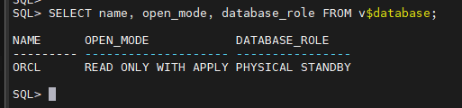
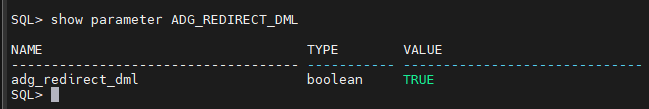
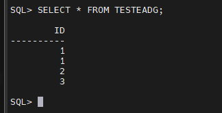

Resposta curta: sim, no 19c dá, usando DML Redirection no Active Data Guard. A sessão conecta no standby, manda um DML incidental e o Oracle redireciona para o primary, executa lá, gera o redo e aplica de volta no standby. Você mantém leitura consistente no standby e reduz atrito com ferramentas que às vezes precisam escrever um pouco.

## Meu ambiente de teste

```
Protection Mode: MaxPerformance
Members:
  orcl   - Primary database
  orcldg - Physical standby database
  orcldr - Physical standby database
```

No standby, confirmei:

- OPEN_MODE = READ ONLY WITH APPLY
- ADG_REDIRECT_DML = TRUE



parameter ADG_REDIRECT_DML



## Quando faz sentido usar

- Aplicações read-mostly que fazem DML pontual, tipo gravação de log, marcação de status, criação de tabelas auxiliares
- Relatórios e ETLs leves que rodam no standby mas precisam escrever metadados mínimos

Não é para mover carga de escrita para o standby. O commit vai pagar a ida até o primary e a volta.

## Pré-requisitos

- Standby aberto como READ ONLY WITH APPLY
- Parâmetro `ADG_REDIRECT_DML` habilitado em nível de sistema ou sessão
- Usuário, objeto e privilégios válidos no primary, porque o DML será executado lá
- Licença de Oracle Active Data Guard

## Como habilitar

Opção sistema

```
ALTER SYSTEM SET ADG_REDIRECT_DML=TRUE;
```

Em RAC, você pode isolar por instância via serviços.

## Teste rápido passo a passo

1. Validar que o standby está aplicando redo em tempo real

```
-- Standby
SELECT name, open_mode, database_role FROM v$database;
-- Esperado: READ ONLY WITH APPLY | PHYSICAL STANDBY
```

2. Habilitar o redirect e executar um DML no standby com um usuário de aplicação

```
-- Standby
ALTER SYSTEM SET ADG_REDIRECT_DML=TRUE;

INSERT INTO testeadg VALUES (1);
COMMIT;
```

3. Conferir no primary

```
-- Primary
SELECT * FROM testeadg;
```
```
-- Validação no standby

SQL> select * from TESTEADG;

        ID
----------
         1
         1

SQL> INSERT INTO TESTEADG VALUES (2);

1 row created.

SQL> commit;

Commit complete.

SQL> select * from testeadg;

        ID
----------
         1
         1
         2
```

## Armadilhas que peguei no lab

Esteja atento a estes dois pontos, porque me fizeram bater cabeça até entender.

1. Conexão como `sqlplus / as sysdba` no standby  
   No meu primeiro teste, conectei no standby com autenticação local do SO: `sqlplus / as sysdba`. O redirecionamento falhou com `ORA-16397`. Para funcionar, eu precisei conectar com usuário e senha via serviço TNS do standby. Exemplo:

```
-- Standby
sqlplus sys@orcl as sysdba

ALTER SYSTEM SET ADG_REDIRECT_DML=TRUE;
INSERT INTO testeadg VALUES (2);
COMMIT;
```

Dica: para teste, use um usuário de aplicação. Evite objetos no esquema `SYS`.

2. Objeto e privilégio no primary  
   O redirect executa no primary como o mesmo usuário. Se a tabela não existir no primary, se estiver em owner diferente, ou se o usuário não tiver privilégio, o Oracle não tem onde aplicar e retorna `ORA-16397`.

## Meu resultado final do teste

Depois de ajustar a conexão e validar os pré-requisitos, a tabela `TESTEADG` apareceu no primary com os registros esperados:

```
ID
--
1
1
2
3
```


## Checklist para produção

- Standby em READ ONLY WITH APPLY
- `ADG_REDIRECT_DML` habilitado nos nós por onde o service passa
- Serviços por função: somente leitura e leitura com redirect
- Mesmo usuário e objetos no primary, com privilégios mínimos necessários
- Auditoria habilitada nos esquemas que podem escrever via redirect
- Medir latência entre sites e acompanhar tempo de commit no AWR/ASH
- Testes de resiliência: simular indisponibilidade parcial do primary e observar a experiência do cliente

## Perguntas rápidas

Dá para usar para batch pesado  
Não. É para DML incidental.

Funciona sem Active Data Guard  
Não. O standby precisa estar em READ ONLY WITH APPLY.

Preciso de senha mesmo sendo SYS  
Sim. Use conexão via TNS com autenticação adequada. Evite usar SYS para criar objetos.


