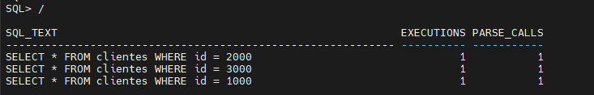
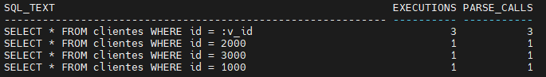

Variáveis de bind são espaços reservados usados dentro de instruções SQL que são substituídos por valores reais em tempo de execução. Em vez de codificar valores específicos diretamente na query, você usa esses espaços para tornar a instrução reutilizável, independentemente do valor passado. Essa abordagem melhora significativamente a performance porque o Oracle pode analisar e otimizar a instrução uma vez e reutilizar o mesmo plano de execução em execuções subsequentes com valores diferentes.

Elas também ajudam a reduzir o *hard parsing*, melhoram a utilização do *shared pool* e tornam a execução de SQL mais eficiente e escalável, especialmente em ambientes OLTP de alta taxa de transações. Em resumo, variáveis de bind são uma das ferramentas fundamentais para escrever queries otimizadas e fáceis de manter.

Um exemplo simples deixa isso claro:

```
-- sem variável de bind
SELECT * FROM clientes WHERE id = 10;

-- com variável de bind
SELECT * FROM clientes WHERE id = :meu_id;
```

Quando você usa uma variável de bind em vez de um valor literal, o Oracle não precisa criar múltiplos *parent cursors* para a mesma instrução. Ele procura por uma correspondência exata no texto antes de analisar, e como o texto da query permanece o mesmo, pode reutilizar o plano de execução já compilado. Isso economiza tempo e recursos, tornando o banco significativamente mais rápido, especialmente em ambientes onde milhares de queries são executadas por segundo.

Uma dúvida comum surge: existe uma forma de consultar todas as variáveis de bind usadas no banco? A resposta é **não**. Não existe uma view que liste todas as variáveis usadas em cada query, porque o Oracle não armazena os valores de bind permanentemente, eles só existem em tempo de execução, dentro de cada cursor no *shared pool*.

### Vantagens e desvantagens

O uso de variáveis de bind traz várias vantagens importantes em termos de performance e escalabilidade. Como a estrutura da query permanece a mesma, independentemente dos valores passados, o Oracle pode analisar e otimizar a instrução uma vez e reutilizar o plano várias vezes. Isso reduz o overhead de *hard parsing*, melhora a utilização do *shared pool* e reduz a contenção no *library cache*. Como resultado, as queries rodam mais rápido, consomem menos recursos e o banco consegue lidar com um volume muito maior de execuções, algo essencial em sistemas OLTP de alto tráfego. Outra vantagem é a **manutenibilidade**: as queries se tornam mais flexíveis e fáceis de adaptar a diferentes entradas sem precisar reescrever o SQL.

Por outro lado, há desvantagens. Como o otimizador não conhece os valores reais durante a análise, ele pode calcular erroneamente a seletividade e escolher um plano de execução subótimo. Em alguns casos, isso pode levar a caminhos de acesso menos eficientes, como *full table scans* em vez de buscas por índice. Além disso, queries que dependem fortemente da distribuição dos dados às vezes têm melhor desempenho com valores literais, pois o otimizador tem informações mais precisas. Recursos como *bind variable peeking* e *adaptive cursor sharing* ajudam a mitigar esses problemas, mas adicionam complexidade. Portanto, embora sejam uma ferramenta poderosa, as variáveis de bind devem ser usadas com cuidado e testadas para garantir os resultados esperados.

---

### Cenário prático: variáveis de bind em ação

Vamos simular um cenário simples para entender como funcionam e por que são tão importantes para a performance de SQL.

1. Criar uma tabela de teste:

```
DROP TABLE clientes PURGE;

CREATE TABLE clientes (
    id NUMBER,
    name VARCHAR2(50)
);
```

2. Popular a tabela com dados:

```
BEGIN
  FOR i IN 1..100000 LOOP
    INSERT INTO clientes VALUES (i, 'Cliente ' || i);
  END LOOP;
  COMMIT;
END;
/
```

3. Consultar **sem variáveis de bind**:

```
SELECT * FROM clientes WHERE id = 1000;
SELECT * FROM clientes WHERE id = 2000;
SELECT * FROM clientes WHERE id = 3000;
```

O Oracle tratará cada uma dessas queries como uma instrução diferente, pois o texto muda a cada execução:

```
SELECT sql_text, executions, parse_calls
FROM v$sql
WHERE sql_text LIKE 'SELECT * FROM clientes WHERE id =%';
```


Você provavelmente verá **três entradas separadas**, cada uma com seu próprio *hard parse*.

4. Consultar **com variáveis de bind**:

```
VARIABLE v_id NUMBER

EXEC :v_id := 1000
SELECT * FROM clientes WHERE id = :v_id;

EXEC :v_id := 2000
SELECT * FROM clientes WHERE id = :v_id;

EXEC :v_id := 3000
SELECT * FROM clientes WHERE id = :v_id;
```

Agora, mesmo com valores diferentes, o Oracle reconhece a query como a mesma instrução e **reutiliza o plano de execução**:

```
SELECT sql_text, executions, parse_calls
FROM v$sql
WHERE sql_text LIKE 'SELECT * FROM clientes WHERE id =%';
```


Dessa vez, você verá apenas **uma única entrada** com múltiplas execuções e um número de *parse_calls* bem menor.

**Sem variáveis de bind:** cada valor gera uma nova entrada no *shared pool*, mais *hard parses*, maior uso de CPU e memória.  
**Com variáveis de bind:** apenas uma entrada é criada, mais *soft parses*, melhor performance e uso de cache.

---

Esse teste simples demonstra um dos princípios fundamentais do *tuning* de SQL: a estrutura da query importa tanto quanto sua lógica. Ao usar valores literais, o banco trata cada execução como uma nova instrução, acionando repetidos *hard parses*, aumentando o uso de CPU e pressionando o *shared pool*. Em contraste, com variáveis de bind, o texto permanece consistente, permitindo a reutilização do plano, reduzindo o overhead e melhorando a eficiência.

Em sistemas OLTP reais, onde milhares ou milhões de queries são executadas por segundo, essa diferença é crítica. O uso correto de variáveis de bind traz desempenho mais estável, melhor escalabilidade e uso previsível de recursos. Porém, como vimos, é importante entender os cenários em que elas podem afetar a escolha do plano pelo otimizador e dominar isso faz parte de se tornar um especialista em performance.

Sempre considere variáveis de bind como escolha padrão ao projetar instruções SQL e analise cuidadosamente os planos de execução ao solucionar problemas de performance. Dominar esse conceito desde cedo é construir uma base sólida para técnicas de *tuning* mais avançadas.
