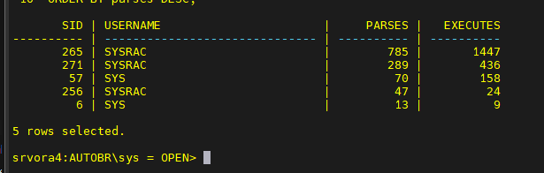
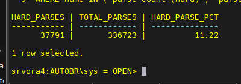
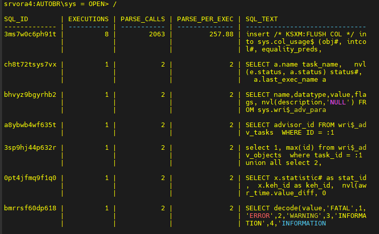
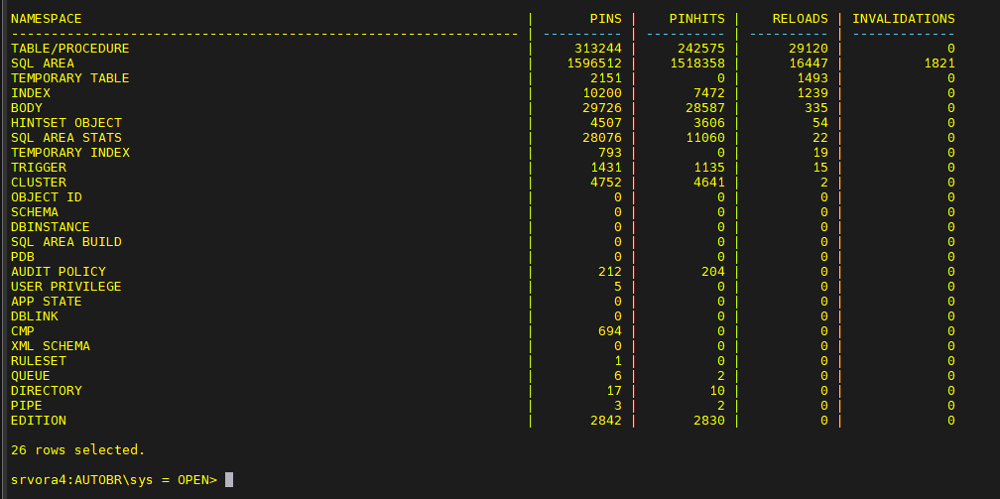

Todo SQL passa por **parse -> execute -> fetch**. O parse é só um detalhe? Não. **Hard parse demais = CPU alta, latch contention e throughput menor.** Em ambientes críticos, isso é a diferença entre fila e fluidez.

### O que é Parsing

Quando um SQL roda no Oracle, ele passa primeiro por **parsing** (antes de executar e buscar linhas). Nesse estágio o banco:

1. valida **sintaxe**
2. valida **objetos/referências**
3. checa **privilégios**
4. procura no **Shared Pool** um cursor compatível (hash/assinatura)
5. se não achar, **aloca memória** e **cria cursor**
6. **gera o plano de execução**

Depois disso, o Oracle segue para as fases **Execute** e **Fetch**.

### Tipos de Parsing

**Soft Parse (Library Cache Hit):** o SQL já está no Shared Pool. O Oracle reaproveita o que foi feito antes (faz só as etapas 1-3). Rápido e barato.

**Hard Parse (Library Cache Miss):** o SQL não está na memória (ou foi aged out). O Oracle precisa planejar de novo. É caro: consome **CPU** e disputa **latches** no Shared Pool, podendo atrasar outras sessões.

### Por que evitar Hard Parse excessivo

1. **Plano é caro** de gerar: picos de CPU e menor throughput.
2. **Shared Pool é concorrente**: muita alocação/serialização = esperas em latches e filas no banco.

### Como medir rapidamente

**Parse vs Execute (visão de sessão):**

```text
-- +-------------------------------------------------------------------------------------------+
-- | Objetivo   : Monitorar Parse vs Execute por sessão no Oracle                              |
-- | Descrição  : Exibe, para cada sessão ativa, a quantidade total de parses e execuções.     |
-- |              Útil para identificar excesso de parsing e baixa taxa de reutilização.       |
-- | Criador    : Gustavo Borges Evangelista                                                   |
-- | Data       : 27/10/2025                                                                   |
-- | Exemplo    : @parse_vs_execute.sql                                                        |
-- | Arquivo    : parse_vs_execute.sql                                                         |
-- | Referência : Conceitos de Parsing - Hard Parse vs Soft Parse                              |
-- +-------------------------------------------------------------------------------------------+
--                                                               . ✦ . · . ✧ . · . ✦ . · . ✧ .
--                                                               ✦     DBA Gustavo Borges     ✦
--                                                               . ✦ . · . ✧ . · . ✦ . · . ✧ .
-- +-------------------------------------------------------------------------------------------+

set linesize 300
col username format a30
SELECT s.sid, s.username, ss.value parses, se.value executes
FROM v$session s
JOIN v$sesstat ss ON s.sid = ss.sid
JOIN v$statname sn1 ON ss.statistic# = sn1.statistic#
JOIN v$sesstat se ON s.sid = se.sid
JOIN v$statname sn2 ON se.statistic# = sn2.statistic#
WHERE sn1.name = 'parse count (total)'
  AND sn2.name = 'execute count'
  AND s.username IS NOT NULL
ORDER BY parses DESC;
```

---



**Taxa de hard parse (instância):**

```text
SELECT
  SUM(CASE WHEN name = 'parse count (hard)' THEN value END) hard_parses,
  SUM(CASE WHEN name = 'parse count (total)' THEN value END) total_parses,
  ROUND(
    100 * SUM(CASE WHEN name = 'parse count (hard)' THEN value END)
        / NULLIF(SUM(CASE WHEN name = 'parse count (total)' THEN value END),0)
  ,2) AS hard_parse_pct
FROM v$sysstat
WHERE name IN ('parse count (hard)', 'parse count (total)');
```

---



**Quem mais “parseia” (SQLs):**

```text
SELECT * FROM (
  SELECT sql_id, executions, parse_calls,
         ROUND(parse_calls/NULLIF(executions,0),2) parse_per_exec,
         substr(sql_text,1,80) sql_text
  FROM v$sqlarea
  WHERE executions > 0
  ORDER BY parse_per_exec DESC
) WHERE ROWNUM <= 20;
```

---



**Contendas no Shared Pool/Library Cache:**

```text
SELECT namespace, pins, pinhits, reloads, invalidations
FROM v$librarycache
ORDER BY reloads DESC;
```

---



### Como reduzir Hard Parse

- **Use bind variables** (evita milhares de literais distintos virarem milhares de cursores).
- Padronize **normalização de literais** na aplicação; use `CURSOR_SHARING=FORCE/SIMILAR` apenas como mitigação temporária.
- Ajuste **SESSION_CACHED_CURSORS** (ex.: 50–200) para reaproveitar parse a nível de sessão.
- Evite concatenar SQL dinâmico com valores; prefira **binds** nos frameworks/ORMs.
- **Tamanho do Shared Pool** adequado e **fragmentação** sob controle.
- Monitore **parse por execução** (idealmente muito menor que 1) e **hard_parse_pct** baixo de forma consistente.
- Reduza **invalidações** (DDL frequente no horário crítico força novos parses).

### Exemplo prático com bind

**Ruim:**

```text
SELECT * FROM orders WHERE customer_id = 101;
SELECT * FROM orders WHERE customer_id = 102;
-- mil literais = mil cursores
```

**Bom:**

```text
SELECT * FROM orders WHERE customer_id = :customer_id;
-- um cursor, mil execuções
```

---

### Conclusão

Se você vê **CPU alta + latch waits**, comece medindo **hard_parse_pct** e **parse_per_exec**.  
**Binds + session_cached_cursors** resolvem mais do que apenas aumentar memória.


