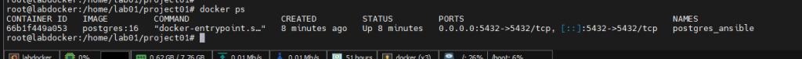
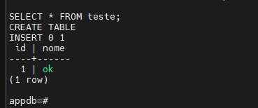
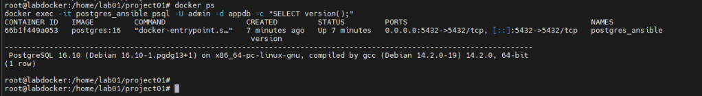

Neste primeiro projeto o objetivo é transformar uma VM limpa em um servidor PostgreSQL usando apenas Ansible e Docker. Tudo roda localmente na própria máquina 192.168.0.101 (sem SSH para outro host): o Ansible é executado dentro da VM, instala o Docker, gera o docker-compose e sobe o contêiner PostgreSQL de forma automatizada.

Abaixo está o passo a passo completo, com caminhos absolutos e comandos `cat` para criação dos arquivos, de forma que qualquer pessoa consiga reproduzir o projeto apenas copiando e colando.

## Estrutura do projeto

No exemplo, o diretório base do projeto será:

```text
/home/lab01/project01
```

Ajuste o lab01 se o seu usuário for outro. Os comandos abaixo consideram que você já está logado na VM.

Crie a estrutura de diretórios:

```text
mkdir -p /home/lab01/project01/playbooks/templates
mkdir -p /home/lab01/project01/vars
cd /home/lab01/project01
```

Ao final, você terá:

```text
/home/lab01/project01/
├── inventory
├── playbooks/
│   ├── install_docker.yml
│   ├── deploy_postgres.yml
│   └── templates/
│       └── docker-compose.yml.j2
└── vars/
    └── postgres.yml
```

Função de cada item:

- inventory: diz ao Ansible quais hosts ele deve gerenciar (aqui será o próprio localhost).
- vars/postgres.yml: centraliza as variáveis do PostgreSQL.
- playbooks/templates/docker-compose.yml.j2: template usado para gerar o docker-compose real.
- playbooks/install_docker.yml: automatiza a instalação do Docker.
- playbooks/deploy_postgres.yml: sobe o PostgreSQL via docker-compose.

## Inventory – rodando local

Como o Ansible será executado na própria VM que vai receber o PostgreSQL, o inventário aponta para 127.0.0.1 com conexão local.

Crie o arquivo de inventory:

```text
cat > /home/lab01/project01/inventory &lt;&lt; 'EOF'
[dbservers]
127.0.0.1 ansible_connection=local
EOF
```

Esse arquivo define um grupo dbservers que aponta para o próprio host local, sem SSH.

## Arquivo de variáveis do PostgreSQL

Crie o arquivo de variáveis:

```text
cat > /home/lab01/project01/vars/postgres.yml << 'EOF'
postgres_version: "16"
postgres_user: "admin"
postgres_password: "Senha123"
postgres_db: "appdb"
postgres_port: 5432
pgdata_path: "/opt/pgdata"
EOF
```

Função de cada variável:

- postgres_version: versão da imagem Docker do PostgreSQL.
- postgres_user / postgres_password: usuário e senha iniciais.
- postgres_db: banco padrão criado ao subir o contêiner.
- postgres_port: porta exposta no host.
- pgdata_path: diretório no host para armazenar os dados do PostgreSQL.

## Template do docker-compose

Crie o template Jinja2 que será usado para gerar o docker-compose final:

```text
cat > /home/lab01/project01/playbooks/templates/docker-compose.yml.j2 << 'EOF'
version: "3.9"

services:
  postgres:
    image: postgres:{{ postgres_version }}
    container_name: postgres_ansible
    environment:
      POSTGRES_USER: {{ postgres_user }}
      POSTGRES_PASSWORD: {{ postgres_password }}
      POSTGRES_DB: {{ postgres_db }}
    ports:
      - "{{ postgres_port }}:5432"
    volumes:
      - "{{ pgdata_path }}:/var/lib/postgresql/data"
EOF
```

O Ansible vai substituir as variáveis ({{ postgres_version }}, {{ postgres_user }}, etc.) com os valores definidos em vars/postgres.yml e salvar o resultado como /opt/docker-compose.yml na VM.

## Playbook para instalar Docker

Esse playbook prepara a VM: instala dependências, adiciona o repositório oficial do Docker e instala Docker + plugin do docker-compose.

Crie o playbook:

```text
cat > /home/lab01/project01/playbooks/install_docker.yml << 'EOF'
- hosts: dbservers
  become: yes
  tasks:
    - name: Instalar dependências
      apt:
        name:
          - apt-transport-https
          - ca-certificates
          - curl
          - gnupg
        state: present
        update_cache: yes

    - name: Adicionar chave GPG do Docker
      apt_key:
        url: <https://download.docker.com/linux/ubuntu/gpg>
        state: present

    - name: Adicionar repositório Docker
      apt_repository:
        repo: "deb [arch=amd64] <https://download.docker.com/linux/ubuntu> focal stable"
        state: present

    - name: Instalar Docker e docker-compose
      apt:
        name:
          - docker-ce
          - docker-ce-cli
          - containerd.io
          - docker-compose-plugin
        state: present
        update_cache: yes
EOF
```

Esse playbook será executado localmente (por causa do inventory) e deixará o Docker pronto para uso na própria VM

## Playbook para deploy do PostgreSQL

Agora o playbook que efetivamente sobe o PostgreSQL via Docker:

```text
cat > /home/lab01/project01/playbooks/deploy_postgres.yml << 'EOF'
- hosts: dbservers
  become: yes
  vars_files:
    - ../vars/postgres.yml

  tasks:
    - name: Criar diretório de dados do PostgreSQL
      file:
        path: "{{ pgdata_path }}"
        state: directory
        mode: '0755'

    - name: Copiar docker-compose para o servidor
      template:
        src: templates/docker-compose.yml.j2
        dest: /opt/docker-compose.yml

    - name: Subir PostgreSQL com Docker Compose
      shell: docker compose -f /opt/docker-compose.yml up -d
      args:
        chdir: /opt
EOF
```

Esse playbook faz três coisas:

1. Garante que o diretório `/opt/pgdata` exista.
2. Gera `/opt/docker-compose.yml` com base no template e nas variáveis.
3. Sobe o contêiner `postgres_ansible` com `docker compose up -d`.

## Executar os playbooks na VM 192.168.0.101

Antes de rodar o Ansible, certifique-se de que ele está instalado:

```text
ansible-playbook --version
```

Se não estiver, instale:

```text
sudo apt update
sudo apt install -y ansible-core
```

Depois, sempre a partir do diretório do projeto:

```text
cd /home/lab01/project01
```

### Instalar Docker

```text
ansible-playbook -i inventory playbooks/install_docker.yml
```

Ao final, a própria VM 192.168.0.101 estará com Docker instalado e pronto.

### Subir PostgreSQL

```text
ansible-playbook -i inventory playbooks/deploy_postgres.yml
```

Esse comando cria o diretório de dados, gera o docker-compose e sobe o contêiner PostgreSQL.

## Validar o ambiente

Agora, ainda na própria VM 192.168.0.101, valide se o contêiner e o banco estão funcionando.

### Verificar se o contêiner está rodando

```text
docker ps
```

Saída esperada (similar):

```text
CONTAINER ID   IMAGE            COMMAND                  STATUS         NAMES
xxxxxxx        postgres:16      "docker-entrypoint.s…"   Up XX seconds  postgres_ansible
```

### Testar conexão com o PostgreSQL

```text
docker exec -it postgres_ansible psql -U admin -d appdb -c "SELECT version();"
```

Você deve ver a versão do PostgreSQL 16.

### Criar e validar uma tabela de teste

Entrando no psql:

```text
docker exec -it postgres_ansible psql -U admin -d appdb
```

Dentro do psql:

```text
CREATE TABLE teste (
    id serial PRIMARY KEY,
    nome text
);

INSERT INTO teste (nome) VALUES ('ok');

SELECT * FROM teste;
```

Saída esperada:



Isso confirma que o banco está aceitando conexões, criando objetos e persistindo dados.

## Testar idempotência e recuperação

### Rodar o playbook de deploy novamente

Do diretório do projeto:

```text
cd /home/lab01/project01
ansible-playbook -i inventory playbooks/deploy_postgres.yml
```

O comportamento esperado é que nada quebre. O playbook deve ser seguro para rodar múltiplas vezes, mantendo o contêiner e o diretório de dados em um estado consistente.

### Simular perda do contêiner e recuperar com Ansible

Pare e remova o contêiner manualmente:

```text
docker rm -f postgres_ansible
```

Depois, reprovisione com o mesmo playbook:

```text
cd /home/lab01/project01
ansible-playbook -i inventory playbooks/deploy_postgres.yml
```

Valide novamente:

```text
docker ps
docker exec -it postgres_ansible psql -U admin -d appdb -c "SELECT version();"
```

O contêiner volta a subir automaticamente e o ambiente fica pronto de novo sem você precisar lembrar comandos de Docker: tudo está descrito na automação.

Ao final desse projeto, a VM 192.168.0.101 se torna um servidor PostgreSQL que pode ser recriado a qualquer momento com Ansible. Toda a configuração está codificada em `/home/lab01/project01`, com playbooks e templates versionáveis, reexecutáveis e validados na prática. É o primeiro passo para tratar infraestrutura de banco de dados como código, com reprodutibilidade e controle total.
