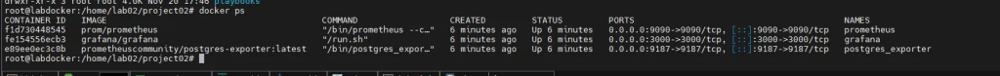
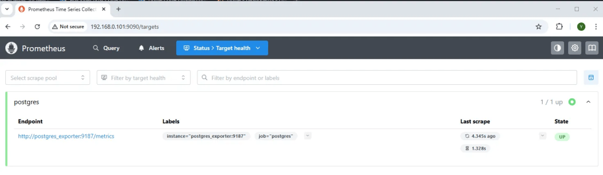
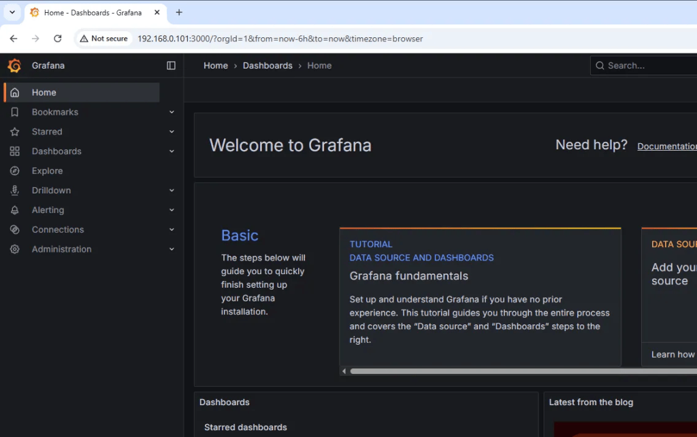
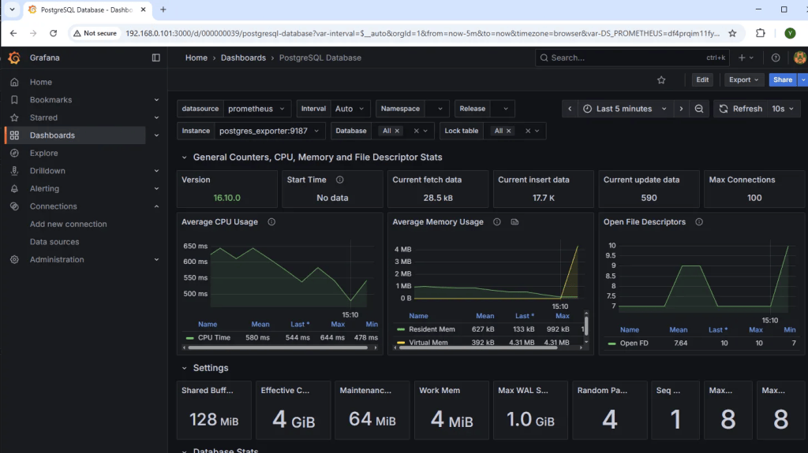

Neste segundo projeto da série, o objetivo é construir um stack de monitoramento completo para PostgreSQL usando Prometheus, Postgres Exporter e Grafana, tudo executado via Docker. A automação será totalmente gerenciada pelo Ansible, rodando **localmente** na mesma VM 192.168.0.101, exatamente como no Projeto 1.

O resultado é um ambiente onde, com dois comandos, você instala Docker (caso não exista), sobe o Exporter, Prometheus e Grafana, e valida que as métricas do PostgreSQL estão sendo coletadas e exibidas em dashboards.

# Estrutura do projeto

Diretório base:

```
<code>/home/lab02/project02</code>
```

Criação da estrutura:

```
mkdir -p /home/lab02/project02/playbooks/templates
mkdir -p /home/lab02/project02/vars
cd /home/lab02/project02
```

Estrutura final:

```
/home/lab02/project02/
├── inventory
├── vars/
│   └── monitoring.yml
├── playbooks/
│   ├── install_docker.yml
│   ├── deploy_monitoring.yml
│   └── templates/
│       ├── docker-compose-monitoring.yml.j2
│       └── prometheus.yml.j2
```

Função de cada parte:

- inventory → define o host local (Ansible sem SSH)
- vars/monitoring.yml → define portas e configurações dos serviços
- docker-compose-monitoring.yml.j2 → sobe Prometheus/Exporter/Grafana
- prometheus.yml.j2 → configura Prometheus para coletar métricas do PostgreSQL
- install_docker.yml → instala Docker (mesmo playbook do projeto 1)
- deploy_monitoring.yml → sobe toda stack de monitoramento

# Inventory – conexão local

```
cat > /home/lab02/project02/inventory &lt;&lt; 'EOF'
[dbservers]
127.0.0.1 ansible_connection=local
EOF
```

127.0.0.1 ansible_connection=local EOF

# Variáveis de monitoramento

Crie:

```
cat > /home/lab02/project02/vars/monitoring.yml << 'EOF'
prometheus_port: 9090
grafana_port: 3000
exporter_port: 9187
postgres_user: "admin"
postgres_password: "Senha123"
postgres_host: "127.0.0.1"
postgres_db: "appdb"
EOF
```

Essas variáveis configuram:

- portas de cada serviço
- credenciais de acesso ao PostgreSQL
- endereço do banco (a mesma VM 192.168.0.101, porém localhost, já que tudo roda local)

# Template do docker-compose (monitoramento)

Crie:

```
cat > /home/lab02/project02/playbooks/templates/docker-compose-monitoring.yml.j2 << 'EOF'
version: "3.9"

services:

	postgres:
    image: postgres:16
    container_name: postgres_monitoring
    environment:
      POSTGRES_USER: {{ postgres_user }}
      POSTGRES_PASSWORD: {{ postgres_password }}
      POSTGRES_DB: {{ postgres_db }}
    ports:
      - "5432:5432"
    volumes:
      - /opt/pgdata_monitor:/var/lib/postgresql/data

  postgres_exporter:
    image: prometheuscommunity/postgres-exporter:latest
    container_name: postgres_exporter
    environment:
      DATA_SOURCE_NAME: "postgresql://{{ postgres_user }}:{{ postgres_password }}@postgres:5432/{{ postgres_db }}?sslmode=disable"
    ports:
      - "{{ exporter_port }}:9187"

  prometheus:
    image: prom/prometheus
    container_name: prometheus
    volumes:
      - /opt/prometheus.yml:/etc/prometheus/prometheus.yml
    ports:
      - "{{ prometheus_port }}:9090"

  grafana:
    image: grafana/grafana
    container_name: grafana
    ports:
      - "{{ grafana_port }}:3000"
EOF
```

Esse compose sobe:

- postgres_exporter → coleta métricas do PostgreSQL
- prometheus → coleta do exporter
- grafana → visualiza tudo em dashboards

# Template prometheus.yml

Crie:

```
cat > /home/lab02/project02/playbooks/templates/prometheus.yml.j2 << 'EOF'
global:
  scrape_interval: 5s

scrape_configs:
  - job_name: 'postgres'
    static_configs:
      - targets: ['127.0.0.1:{{ exporter_port }}']
EOF
```

Isso diz ao Prometheus para coletar métricas do Exporter.

# Playbook para instalação do Docker

Mesmo playbook do projeto 1. Criar:

```
cat > /home/lab02/project02/playbooks/install_docker.yml << 'EOF'
- hosts: dbservers
  become: yes
  tasks:
    - name: Instalar dependências
      apt:
        name:
          - apt-transport-https
          - ca-certificates
          - curl
          - gnupg
        state: present
        update_cache: yes

    - name: Adicionar chave GPG do Docker
      apt_key:
        url: <https://download.docker.com/linux/ubuntu/gpg>
        state: present

    - name: Adicionar repositório Docker
      apt_repository:
        repo: "deb [arch=amd64] <https://download.docker.com/linux/ubuntu> focal stable"
        state: present

    - name: Instalar Docker e docker-compose
      apt:
        name:
          - docker-ce
          - docker-ce-cli
          - containerd.io
          - docker-compose-plugin
        state: present
```

# Playbook para deploy do monitoring

```
cat > /home/lab02/project02/playbooks/deploy_monitoring.yml << 'EOF'
- hosts: dbservers
  become: yes
  vars_files:
    - ../vars/monitoring.yml

  tasks:
    - name: Gerar configuração do Prometheus
      template:
        src: templates/prometheus.yml.j2
        dest: /opt/prometheus.yml

    - name: Gerar docker-compose do monitoring
      template:
        src: templates/docker-compose-monitoring.yml.j2
        dest: /opt/docker-compose-monitoring.yml

    - name: Subir stack de monitoramento
      shell: docker compose -f /opt/docker-compose-monitoring.yml up -d
      args:
        chdir: /opt
EOF
```

Esse playbook:

1. gera /opt/prometheus.yml
2. gera /opt/docker-compose-monitoring.yml
3. sobe Prometheus, Exporter e Grafana

# Execução na VM 192.168.0.101

Entre no diretório:

```
cd /home/lab02/project02
```

### Instalar Docker (caso ainda não exista)

```
ansible-playbook -i inventory playbooks/install_docker.yml
```

### Subir o stack de monitoramento

```
ansible-playbook -i inventory playbooks/deploy_monitoring.yml
```

# Validação do ambiente

### Verificar se os containers estão rodando

```
docker ps
```

Resultado esperado:

```
postgres_exporter
prometheus
grafana
```

### Testar acesso ao Prometheus

Acesse no navegador:

```
http://192.168.0.101:9090
```

### Testar Grafana

Acesse:

```
http://192.168.0.101:3000
```

Login padrão:

```
admin / admin
```

Após login, importe o dashboard padrão do postgres_exporter:

ID no Grafana.com:

```
9628
```

Isso abrirá um dashboard completo com:

- conexões
- locks
- blocos lidos
- deadlocks
- queries ativas
- uso de memória
- cache hit ratio



### Teste final: parar e restaurar

```
docker rm -f postgres_monitoring postgres_exporter prometheus grafana
ansible-playbook -i inventory playbooks/deploy_monitoring.yml
docker ps
```

Os serviços voltam como novos.

O Projeto 2 entrega um ambiente completo de monitoramento para PostgreSQL, provisionado automaticamente via Ansible, rodando local na própria VM 192.168.0.101. A stack Exporter + Prometheus + Grafana se conecta ao PostgreSQL criado no Projeto 1 e exibe métricas em tempo real, incluindo locks, conexões, tamanho do banco, consumo de recursos e estatísticas internas.

Esse laboratório mostra a base operacional que qualquer Database Engineer deve dominar: instrumentação, coleta e visualização de métricas em um ambiente moderno e replicável.
