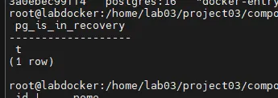
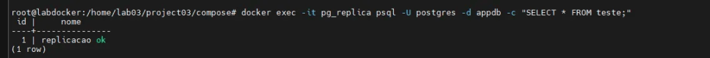
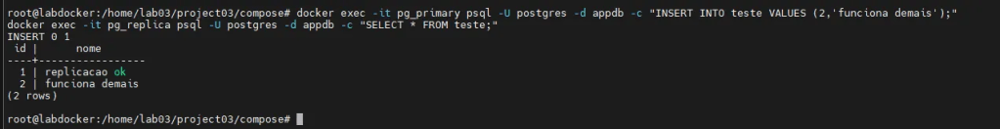

Hoje vamos montar um ambiente PostgreSQL com replicação física **do zero**, usando **dois containers Docker**: um *primary* e um *standby replica*.

Esse laboratório funciona 100%, está enxuto, prático e serve como base para qualquer ambiente maior.

# Estrutura do Projeto

```text
project03/
├── primary_data/    (dados primary)
├── replica_data/    (dados replica)
└── compose/
    └── docker-compose.yml
```

Essa estrutura deixa tudo organizado, com dados persistentes e compose isolado.

# Preparando diretórios do projeto

Crie tudo com:

```text
mkdir -p /home/lab03/project03/{primary_data,replica_data,compose}
cd /home/lab03/project03/compose
```

# Criando o docker-compose.yml

Arquivo:

```text
/home/lab03/project03/compose/docker-compose.yml
```

Crie assim:

```text
cat > /home/lab03/project03/compose/docker-compose.yml <<EOF
services:
  pg_primary:
    image: postgres:16
    container_name: pg_primary
    environment:
      POSTGRES_PASSWORD: postgres
      POSTGRES_DB: appdb
    ports:
      - "5432:5432"
    volumes:
      - /home/lab03/project03/primary_data:/var/lib/postgresql/data
    networks:
      - pgnet

networks:
  pgnet:
    driver: bridge
EOF
```

Esse compose sobe **apenas o primary** — o replica será criado depois (intencionalmente), como fluxo real de um standby.

# Subindo o Primary

```text
cd /home/lab03/project03/compose
docker compose up -d
docker ps
```

Teste rápido:

```text
docker exec -it pg_primary psql -U postgres -d appdb -c "SELECT 'PRIMARY OK' AS status;"
```

Crie uma tabela de teste:

```text
docker exec -it pg_primary psql -U postgres -d appdb -c "CREATE TABLE teste (id int, nome text);"
docker exec -it pg_primary psql -U postgres -d appdb -c "INSERT INTO teste VALUES (1,'replicacao ok');"
```

# Ajustando pg_hba.conf do Primary (liberar replicação)

Entre no container:

```text
docker exec -it pg_primary bash
```

Edite o arquivo, adicione no final:

```text
echo "host    replication     postgres        0.0.0.0/0            trust" >> $PGDATA/pg_hba.conf
echo "host    all             all             0.0.0.0/0            trust" >> $PGDATA/pg_hba.conf
```

Saia e reinicie:

```text
exit
docker restart pg_primary
```

# Limpando a pasta da Replica (garantir ambiente zero)

```text
rm -rf /home/lab03/project03/replica_data/*
```

# Executando pg_basebackup para preparar o Standby

```text
docker run --rm \
  --network compose_pgnet \
  -e PGPASSWORD=postgres \
  -v /home/lab03/project03/replica_data:/var/lib/postgresql/data \
  postgres:16 \
  bash -c "pg_basebackup -h pg_primary -p 5432 -U postgres -D /var/lib/postgresql/data -Fp -Xs -P -R"
```

Se aparecer:

```text
waiting for checkpoint
30775/30775 kB ... OK
```

Perfeito.

# Ajustando permissões (importantíssimo)

```text
chown -R 999:999 /home/lab03/project03/replica_data
```

# Subindo o container da réplica

```text
docker run -d \\
  --name pg_replica \\
  --network compose_pgnet \\
  -e POSTGRES_PASSWORD=postgres \\
  -p 5433:5432 \\
  -v /home/lab03/project03/replica_data:/var/lib/postgresql/data \\
  postgres:16
```

Verifique:

```text
docker ps
```

# Testando se a réplica está em modo recovery

```text
docker exec -it pg_replica psql -U postgres -c "SELECT pg_is_in_recovery();"
```

Resultado esperado:



Testando leitura dos dados:

```text
docker exec -it pg_replica psql -U postgres -d appdb -c "SELECT * FROM teste;"
```

Esperado:



A REPLICAÇÃO ESTÁ FUNCIONANDO!!! Xique demais.

# Teste Final: Inserindo no Primary e lendo no Standby

```text
docker exec -it pg_primary psql -U postgres -d appdb -c "INSERT INTO teste VALUES (2,'funciona demais');"
docker exec -it pg_replica psql -U postgres -d appdb -c "SELECT * FROM teste;"
```

Output esperado:



Pronto!

Esse projeto mostra na prática:

- Como montar um PostgreSQL primary limpo
- Como configurar replicação física real
- Como preparar um standby via pg_basebackup
- Como validar e confirmar a replicação
- Como organizar o projeto para um laboratório reutilizável

E a partir daqui você já consegue:

- Escalar para múltiplos standbys
- Criar failover manual
- Automatizar com Patroni ou repmgr
- Integrar monitoramento e alertas

Esse foi o **Projeto 3/10** da minha série prática sobre PostgreSQL e Engenharia de Banco de Dados.
