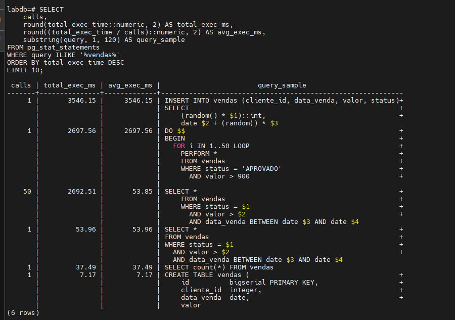
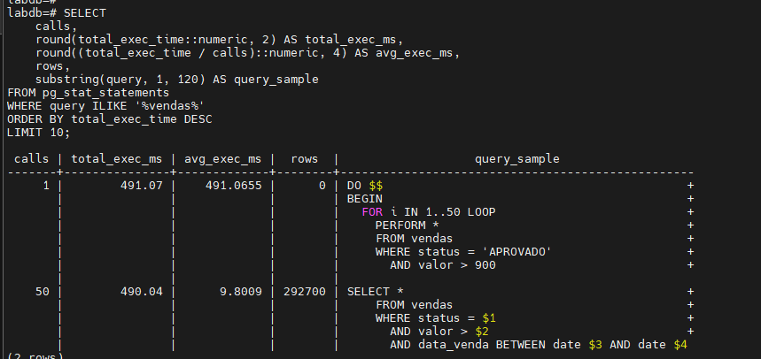
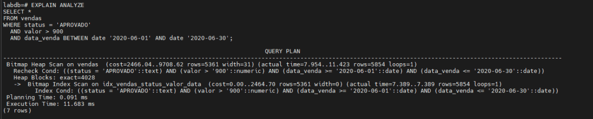

Este projeto cria um laboratório simples e reprodutível em Docker para analisar e otimizar queries usando pg_stat_statements e pgbench.

Você vai gerar carga, identificar queries pesadas, otimizar com índice e comparar antes/depois com métricas reais do PostgreSQL.

A ideia é simular exatamente o fluxo de troubleshooting em ambiente real:

investigar, reproduzir, medir, corrigir e validar.

## Estrutura do ambiente

Antes de começarmos a medir e comparar performance, precisamos de um ambiente isolado, limpo e fácil de reconstruir. Por isso estamos colocando tudo dentro de:

```text
/home/lab04/projetos-dbengine/projeto04
```

Nesta pasta ficarão:

- o docker-compose.yml
- o diretório data/ com os arquivos reais do PostgreSQL

Isso garante que você não afeta nenhum banco do seu sistema e pode repetir o laboratório quantas vezes quiser.

## Criando diretórios

Crie o diretório principal do projeto:

```text
mkdir -p /home/lab04/projetos-dbengine/projeto04
cd /home/lab04/projetos-dbengine/projeto04
```

A ideia é manter padronização entre os projetos da série.

## Criando o docker-compose.yml

O arquivo abaixo sobe um PostgreSQL 16 já configurado com pg_stat_statements.

Não precisa abrir editor: apenas copie e cole o comando completo.

```text
cat << 'EOF' > /home/lab04/projetos-dbengine/projeto04/docker-compose.yml

services:
  postgres:
    image: postgres:16
    container_name: pg_tuning
    restart: always
    environment:
      - POSTGRES_USER=admin
      - POSTGRES_PASSWORD=SenhaForte123
      - POSTGRES_DB=labdb
    ports:
      - "5432:5432"
    volumes:
      - /home/lab04/projetos-dbengine/projeto04/data:/var/lib/postgresql/data
    command:
      - "postgres"
      - "-c"
      - "shared_preload_libraries=pg_stat_statements"
      - "-c"
      - "pg_stat_statements.max=10000"
      - "-c"
      - "pg_stat_statements.track=all"
EOF
```

O ponto mais importante é o shared_preload_libraries:

sem isso, o pg_stat_statements não funciona.

## Diretório de dados

Criamos também a pasta onde os arquivos do banco serão armazenados:

```text
mkdir -p /home/lab04/projetos-dbengine/projeto04/data
```

## Subindo o PostgreSQL

Agora subimos o contêiner:

```text
docker compose -f /home/lab04/projetos-dbengine/projeto04/docker-compose.yml up -d
```

E validamos se está ativo:

```text
docker ps
```

Se pg_tuning estiver como **Up**, estamos prontos.

## Criando a extensão pg_stat_statements

Acesse o contêiner:

```text
docker exec -it pg_tuning bash
```

Entre no banco:

```text
psql -U admin -d labdb
```

Crie a extensão:

```text
CREATE EXTENSION IF NOT EXISTS pg_stat_statements;
```

Confirme:

```text
SELECT * FROM pg_extension WHERE extname = 'pg_stat_statements';
```

Se aparecer, o monitoramento de queries já está ativo.

## Inicializando o pgbench

O pgbench será usado para gerar carga no banco. Assim evitamos testes artificiais demais.

Saia do psql:

```text
\q
```

Execute:

```text
pgbench -U admin -d labdb -i
```

Isso cria tabelas padrão e inicializa o ambiente de benchmark.

## Criando a tabela de teste

Agora criaremos uma tabela propositalmente desindexada para simular lentidão.

Entre novamente no psql:

```text
psql -U admin -d labdb
```

Crie a tabela:

```text
CREATE TABLE vendas (
    id          bigserial PRIMARY KEY,
    cliente_id  integer,
    data_venda  date,
    valor       numeric(12,2),
    status      text
);
```

Popule com 1 milhão de registros:

```text
INSERT INTO vendas (cliente_id, data_venda, valor, status)
SELECT
    (random() * 10000)::int,
    date '2020-01-01' + (random() * 365)::int,
    (random() * 1000)::numeric(12,2),
    CASE
        WHEN random() < 0.7 THEN 'APROVADO'
        WHEN random() < 0.9 THEN 'PENDENTE'
        ELSE 'CANCELADO'
    END
FROM generate_series(1, 1000000);
```

Confirme:

```text
SELECT count(*) FROM vendas;
```

Se retornar 1.000.000, tudo certo.

Saia:

```text
\q
```

## Gerando carga com pgbench

Aqui aquecemos o banco para gerar estatísticas reais.

```text
pgbench -U admin -d labdb -c 10 -j 4 -T 60
```

Essa carga cria ruído saudável para o pg_stat_statements.

## Gerando carga problemática

Agora vamos simular uma query pesada. Entre no psql novamente:

```text
psql -U admin -d labdb
```

Execute algumas vezes:

```text
SELECT *
FROM vendas
WHERE status = 'APROVADO'
  AND valor > 900
  AND data_venda BETWEEN date '2020-06-01' AND date '2020-06-30';
```

E gere mais volume:

```text
DO $$
BEGIN
  FOR i IN 1..50 LOOP
    PERFORM *
    FROM vendas
    WHERE status = 'APROVADO'
      AND valor > 900
      AND data_venda BETWEEN date '2020-06-01' AND date '2020-06-30';
  END LOOP;
END;
$$;
```

Saia:

```text
\q
```

## Analisando queries no pg_stat_statements (SELECT corrigido)

Entre novamente:

```text
psql -U admin -d labdb
```

Veja as queries que mais consumiram tempo:

```text
SELECT
    queryid,
    calls,
    round(total_exec_time::numeric, 2) AS total_exec_ms,
    round((total_exec_time / calls)::numeric, 2) AS avg_exec_ms,
    rows,
    shared_blks_hit,
    shared_blks_read,
    substring(query, 1, 80) AS query_sample
FROM pg_stat_statements
WHERE dbid = (SELECT oid FROM pg_database WHERE datname = 'labdb')
ORDER BY total_exec_time DESC
LIMIT 10;
```

Agora filtrar só monstros:

```text
SELECT
    calls,
    round(total_exec_time::numeric, 2) AS total_exec_ms,
    round((total_exec_time / calls)::numeric, 2) AS avg_exec_ms,
    substring(query, 1, 120) AS query_sample
FROM pg_stat_statements
WHERE query ILIKE '%vendas%'
ORDER BY total_exec_time DESC
LIMIT 10;
```

Anote o tempo médio por execução: usaremos daqui a pouco para comparar.

## Otimizando a query

Agora sim aplicamos uma otimização real: um índice composto.

```text
CREATE INDEX idx_vendas_status_valor_data
    ON vendas (status, valor, data_venda);
```

Atualize estatísticas:

```text
ANALYZE vendas;
```

Zere estatísticas do statements:

```text
SELECT pg_stat_statements_reset();
```

E gere a carga problemática novamente:

```text
DO $$
BEGIN
  FOR i IN 1..50 LOOP
    PERFORM *
    FROM vendas
    WHERE status = 'APROVADO'
      AND valor > 900
      AND data_venda BETWEEN date '2020-06-01' AND date '2020-06-30';
  END LOOP;
END;
$$;
```

Consulte novamente:

```text
SELECT
    calls,
    round(total_exec_time::numeric, 2) AS total_exec_ms,
    round((total_exec_time / calls)::numeric, 4) AS avg_exec_ms,
    rows,
    substring(query, 1, 120) AS query_sample
FROM pg_stat_statements
WHERE query ILIKE '%vendas%'
ORDER BY total_exec_time DESC
LIMIT 10;
```

E compare o plano:

```text
EXPLAIN ANALYZE
SELECT *
FROM vendas
WHERE status = 'APROVADO'
  AND valor > 900
  AND data_venda BETWEEN date '2020-06-01' AND date '2020-06-30';
```

O ganho costuma ser alto, dependendo da distribuição dos dados.

Saia:

```text
\q
```

## Derrubando o ambiente

```text
docker compose -f /home/lab04/projetos-dbengine/projeto04/docker-compose.yml down
```

Para remover tudo:

```text
rm -rf /home/lab04/projetos-dbengine/projeto04/data
```

Este laboratório mostrou, de forma prática e direta, como um Database Engineer pode controlar todo o ciclo de análise e otimização de queries usando ferramentas nativas do PostgreSQL.

Você construiu um ambiente totalmente reprodutível, gerou carga realista, identificou a query problemática com base em métricas confiáveis, aplicou uma otimização concreta e comprovou o resultado comparando antes e depois.

Mais do que apenas criar um índice, o objetivo foi demonstrar **metodologia**: medir primeiro, agir depois, validar sempre.

Este é o padrão real de tuning profissional e agora você tem um laboratório completo para aplicar, mostrar ou ensinar.
