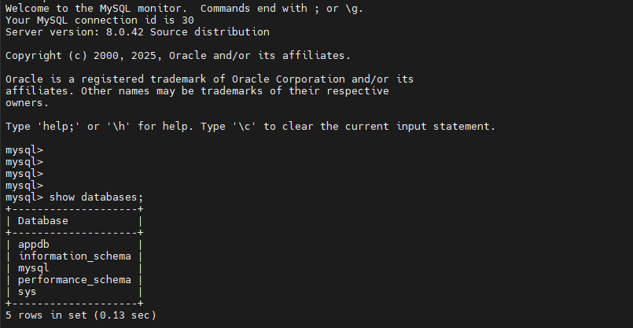

Nos últimos dias resolvi colocar em prática algo que estava estudando: automatizar a criação de recursos em nuvem usando Terraform.  
O objetivo foi simples: criar um banco de dados MySQL no Amazon RDS de forma totalmente automatizada, partindo do zero.

O ambiente:

- AWS como provider
- Terraform rodando em uma máquina Linux
- Banco MySQL 8.x criado via RDS
- Segurança configurada com regra de acesso pelo meu IP

Antes de começar a escrever o código, o ponto mais importante é estruturar o projeto corretamente.  
O Terraform funciona com base em arquivos `.tf` que descrevem toda a infraestrutura que você quer criar, por isso, a ideia é deixar cada parte organizada e reutilizável.

A estrutura que usei foi bem simples, mas funcional: um arquivo para versões e providers, outro para variáveis, um para a configuração do RDS e outro para as saídas (outputs).  
Assim, se eu quiser criar outros bancos ou ambientes no futuro (por exemplo, um Oracle ou PostgreSQL), basta replicar essa base e ajustar os parâmetros.

Iniciando o projeto, crie conforme abaixo a estrutura de arquivos dentro da pasta **terraform-aws-mysql-rds.**  
Esses arquivos são responsáveis por definir toda a infraestrutura que o Terraform vai provisionar desde o provedor (AWS), variáveis e parâmetros, até a configuração do banco MySQL e as saídas com o endpoint final.

## 1) Estrutura do projeto

```
mkdir terraform-aws-mysql-rds && cd terraform-aws-mysql-rds
```

Arquivos:

```
versions.tf
providers.tf
variables.tf
rds.tf
outputs.tf
terraform.tfvars  
```

## 2) Arquivos Terraform

### versions.tf

Define as versões mínimas do Terraform e do provider AWS que serão utilizadas no projeto.  
Serve para garantir compatibilidade e evitar que versões diferentes causem erros durante o deploy.

```
terraform {
  required_version = ">= 1.5.0"
  required_providers {
    aws = {
      source  = "hashicorp/aws"
      version = ">= 5.0"
    }
  }
}
```

### providers.tf

Indica qual provedor de nuvem será usado neste caso, a **AWS**, e em qual região os recursos serão criados.  
É aqui que o Terraform entende onde deve atuar.

```
provider "aws" {
  region = var.aws_region
}
```

### variables.tf

Lista todas as variáveis usadas no projeto (como senha, nome do usuário e IP autorizado).  
Essas variáveis permitem que o código seja reutilizado e configurado sem precisar alterar os arquivos principais.

```
variable "aws_region" {
  type        = string
  description = "AWS region"
  default     = "us-east-1"
}

variable "db_username" {
  type        = string
  description = "Master username (RDS)"
  default     = "admin"
}

variable "db_password" {
  type        = string
  description = "Master password (RDS)"
  sensitive   = true
}

variable "my_ip_cidr" {
  type        = string
  description = "Seu IP público em /32 para liberar acesso"
}

variable "db_name" {
  type        = string
  description = "Nome do database inicial (MySQL)"
  default     = "appdb"
}
```

### rds.tf *(usa VPC default só para laboratório)*

É o coração do projeto. Aqui ficam as definições dos recursos que o Terraform vai criar o **Security Group**, o **Subnet Group** e a **instância RDS MySQL**.  
Tudo que for realmente provisionado na AWS está declarado nesse arquivo.

```
# VPC/Subnets padrão (apenas para demo)
data "aws_vpc" "default" {
  default = true
}

data "aws_subnets" "default" {
  filter {
    name   = "vpc-id"
    values = [data.aws_vpc.default.id]
  }
}

resource "aws_db_subnet_group" "db" {
  name       = "demo-mysql-subnets"
  subnet_ids = data.aws_subnets.default.ids
}

resource "aws_security_group" "rds" {
  name        = "sg-demo-mysql-rds"
  description = "Allow MySQL from my IP"
  vpc_id      = data.aws_vpc.default.id

  ingress {
    description = "MySQL 3306 from my IP"
    from_port   = 3306
    to_port     = 3306
    protocol    = "tcp"
    cidr_blocks = [var.my_ip_cidr]
  }

  egress {
    from_port   = 0
    to_port     = 0
    protocol    = "-1"
    cidr_blocks = ["0.0.0.0/0"]
  }
}

resource "aws_db_instance" "mysql" {
  identifier               = "demo-mysql-rds"
  engine                   = "mysql"
  engine_version           = "8.0"             # pode fixar uma menor/específica se quiser
  instance_class           = "db.t3.micro"     # gratuito p/ labs
  allocated_storage        = 20                # GB
  storage_type             = "gp3"

  username                 = var.db_username
  password                 = var.db_password
  db_name                  = var.db_name       # cria DB inicial

  db_subnet_group_name     = aws_db_subnet_group.db.name
  vpc_security_group_ids   = [aws_security_group.rds.id]

  publicly_accessible      = true              # apenas para laboratório
  multi_az                 = false             # manter custo baixo
  backup_retention_period  = 0                 # sem backup automático no lab
  deletion_protection      = false
  skip_final_snapshot      = true              

  apply_immediately        = true
}

output "mysql_endpoint" {
  description = "Endpoint do MySQL RDS"
  value       = aws_db_instance.mysql.address
}

output "mysql_port" {
  value = aws_db_instance.mysql.port
}
```

### outputs.tf

Define o que o Terraform deve exibir ao final da execução (por exemplo, o endpoint e a porta do banco).  
Essas saídas ajudam a visualizar rapidamente as informações mais importantes depois do deploy.

```
output "connect_example" {
  value = "mysql -h ${aws_db_instance.mysql.address} -P ${aws_db_instance.mysql.port} -u ${var.db_username} -p ${var.db_name}"
}
```

### terraform.tfvars

Armazena os valores reais das variáveis definidas no variables.tf, como a senha do banco e o IP autorizado.  
É um arquivo local e **não deve ser enviado para o GitHub**, pois contém dados sensíveis.

```
db_password = "StrongPassw0rd!"
my_ip_cidr  = "SEU.IP.PUBLICO/32"
```
> curl ifconfig.me  
> rode esse comando para pegar seu "my_ip_cidr" o valor, coloca na variavel

## 3) Executar

Dentro do projeto do terraform:

```
terraform init
terraform apply -auto-approve
```

No final, veja o **endpoint** e o exemplo de conexão nos outputs.

## 4) Conectar no MySQL

```
mysql -h <endpoint> -P 3306 -u admin -p appdb
# digite a senha quando solicitado
```

## 5) Encerrar (evitar custos)

```
terraform destroy -auto-approve
```

Em menos de 5 minutos eu tinha um RDS MySQL rodando na AWS, criado de forma 100% automatizada com Terraform.  
Esse projeto me ajudou a entender na prática como usar infraestrutura como código para bancos de dados e abre espaço para algo maior: criar pipelines automatizados e integrações com ambientes multicloud.


