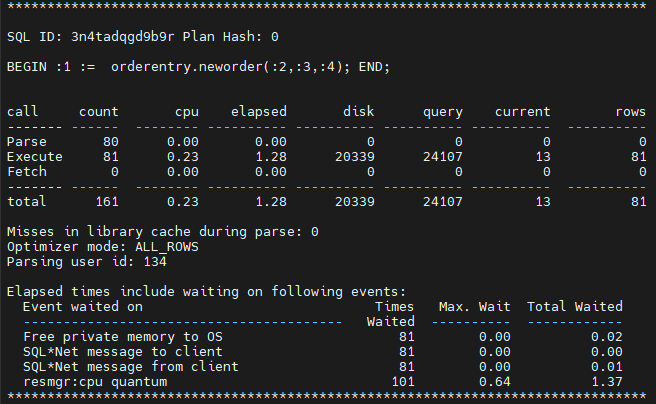

Quando falamos em tuning de performance SQL no Oracle, a maioria das pessoas pensa imediatamente em reescrever consultas, criar índices ou ajustar parâmetros.  
Mas a verdade é que, antes de corrigir qualquer coisa, você precisa entender onde está o verdadeiro problema, e é exatamente aí que entra o TKPROF.

O TKPROF não otimiza seu SQL magicamente. Ele não reescreve consultas nem as faz rodar mais rápido por conta própria.  
O que ele faz é mostrar de forma clara o que está acontecendo nos bastidores: quanto tempo suas consultas gastam em parse, execute e fetch, quantos recursos consomem e onde os gargalos estão escondidos.

Em outras palavras, o TKPROF não é a ferramenta que faz o tuning, é a ferramenta que mostra o que precisa ser ajustado.  
E se você leva a sério o diagnóstico e a resolução de problemas de performance, dominar o TKPROF é uma das habilidades mais valiosas que um DBA Oracle pode ter.

## Como o TKPROF funciona na prática

Antes de usar o TKPROF, é necessário gerar um arquivo de trace.  
Esse arquivo contém informações detalhadas sobre a execução de instruções SQL, incluindo estatísticas de parse, execute e fetch, tempo de CPU e de execução, operações de I/O e muito mais.  
O trace é o material bruto que o TKPROF vai formatar e organizar em um relatório legível.

### 1. Habilitando o SQL Trace

Antes de analisar qualquer coisa com o TKPROF, é preciso gerar o trace file.  
O Oracle permite habilitar o SQL trace de várias formas, dependendo do que você deseja monitorar.

#### a) Habilitar o trace na sessão atual

Essa é a abordagem mais comum quando você quer rastrear as consultas que executará na sua própria sessão.

```sql
ALTER SESSION SET sql_trace = TRUE;
```

Depois de habilitar, execute a consulta ou o conjunto de testes que deseja analisar.  
Quando terminar, desabilite o trace:

```sql
ALTER SESSION SET sql_trace = FALSE;
```

#### b) Habilitar o trace para uma sessão específica

Se a carga estiver sendo executada em outra sessão (por exemplo, um teste do Swingbench ou uma query iniciada de outro terminal), ainda é possível rastreá-la.  
Primeiro, identifique o SID e o SERIAL# da sessão:

```sql
SET linesize window
COL "usuario analise" FORMAT a30
SELECT sid "SID", serial#, username "USUARIO ANALISE"
FROM v$session
WHERE username = 'SOE';
```

Depois, habilite o trace para essa sessão:

```sql
EXEC DBMS_MONITOR.SESSION_TRACE_ENABLE(session_id => 123, serial_num => 45678);
```

Todos os comandos executados nessa sessão serão rastreados a partir desse ponto.  
Você pode desativar depois com:

```sql
EXEC DBMS_MONITOR.SESSION_TRACE_DISABLE(session_id => 123, serial_num => 45678);
```

#### c) Habilitar o trace para um usuário ou serviço específico

Se quiser rastrear todas as sessões de um determinado usuário ou serviço (por exemplo, uma ferramenta de teste de carga ou uma aplicação específica), é possível fazer isso globalmente:

```sql
EXEC DBMS_MONITOR.CLIENT_ID_TRACE_ENABLE(client_id => 'SWINGBENCH');
```

ou

```sql
EXEC DBMS_MONITOR.SERV_MOD_ACT_TRACE_ENABLE(service_name => 'MY_SERVICE');
```

Isso é útil quando várias sessões estão ativas e você quer capturar todas sem precisar habilitar uma por uma.

Depois de ativado por qualquer um desses métodos, o Oracle vai gerar um arquivo `.trc` dentro do diretório de trace.  
Esse arquivo é o dado bruto que será processado com o TKPROF no próximo passo.

---

### 2. Executando o TKPROF

O arquivo de trace é extremamente detalhado e difícil de ler.  
O TKPROF transforma esse trace bruto em um relatório legível.  
Você pode executá-lo diretamente pelo comando:

```sql
tkprof /u01/app/oracle/diag/rdbms/DB_NAME/trace/trace_12345.trc output.txt sys=no sort=exeela
```

---

### 3. Analisando o resultado

Depois de processar o trace com o TKPROF, o relatório apresenta uma análise detalhada de como o SQL ou bloco PL/SQL se comportou dentro do banco.  
O exemplo abaixo mostra a saída para o procedimento `orderentry.neworder`, executado 81 vezes durante um teste de carga.



A partir desse relatório, é possível extrair vários insights importantes.  
O tempo total de execução foi de 1,28 segundos, enquanto o tempo de CPU foi de apenas 0,23 segundos.  
Essa diferença significativa indica que a sessão passou a maior parte do tempo aguardando agendamento de CPU, e não executando o código em si.  
A seção de eventos de espera confirma isso, mostrando o evento `resmgr:cpu quantum` com tempo total de espera de 1,37 segundos, um claro sinal de que o Resource Manager está limitando a alocação de CPU para essa sessão.

O relatório também mostra 20.339 leituras físicas e 24.107 *consistent gets*, o que significa que o procedimento acessou e manipulou blocos de dados reais em disco, em vez de trabalhar totalmente em memória.  
Esse é um comportamento típico de uma operação transacional que realiza inserts ou updates.  
A ausência da fase FETCH confirma que nenhum conjunto de resultados foi retornado, o que condiz com o comportamento esperado de uma procedure PL/SQL orientada a DML.  
Além disso, o relatório mostra 81 linhas processadas em 81 execuções, ou seja, cada chamada tratou uma transação individual.

A principal conclusão dessa análise é que o código em si não é o problema.  
A procedure está performando como esperado e é eficiente do ponto de vista SQL.  
O gargalo real é o agendamento de CPU, controlado pelas políticas do Resource Manager.  
Compreender essa diferença é essencial, pois mostra que otimizar a query não vai resolver o problema.  
A solução envolve ajustar as alocações de CPU ou as políticas de grupos de consumidores.

## Cenários reais: o que o TKPROF pode revelar

O verdadeiro valor do TKPROF aparece quando você o utiliza para investigar problemas específicos de performance.  
Ao ler atentamente sua saída, é possível entender exatamente por que uma consulta está lenta e qual tipo de problema está envolvido.  
Abaixo estão alguns cenários comuns onde o TKPROF oferece informações valiosas.

### 1. Tempo alto em Parse – excesso de hard parsing

Se a fase de parse mostrar alto consumo de CPU ou tempo decorrido, geralmente significa que a aplicação está constantemente reprocessando instruções SQL.  
Isso costuma ocorrer quando as queries são geradas dinamicamente sem uso de variáveis bind.

### 2. Tempo alto em Execute – execução custosa

Se a seção de execução domina o relatório, o problema costuma estar relacionado a planos de execução ruins, ausência de índices ou junções ineficientes.

### 3. Tempo alto em Fetch – muitos dados retornados

Se a fase de fetch demora, a consulta pode estar retornando dados demais ou realizando leituras linha a linha de forma ineficiente.

## Conclusão

O TKPROF não é uma solução mágica para resolver problemas de performance.  
Ele é uma ferramenta de diagnóstico que fornece visibilidade completa sobre o comportamento das instruções SQL dentro do banco de dados.  
Ao analisar sua saída, é possível diferenciar o que é realmente um problema de SQL tuning do que é uma limitação de recursos ou um erro de design da aplicação.

Compreender as fases de parse, execute e fetch, ler os eventos de espera e interpretar o uso de recursos permite tomar decisões precisas e embasadas, em vez de agir por tentativa e erro.

Se você trabalha com Oracle e ainda não utilizou o TKPROF, está deixando de lado uma das ferramentas de diagnóstico mais poderosas que temos como DBAs.  
Ele mostra a história real por trás de cada SQL, não apenas o que está lento, mas por que está lento.  
Depois que você entende isso, performance tuning deixa de ser um jogo de adivinhação e se torna uma habilidade.  
Dominar o TKPROF não é opcional para quem quer evoluir de verdade como profissional de banco de dados.


